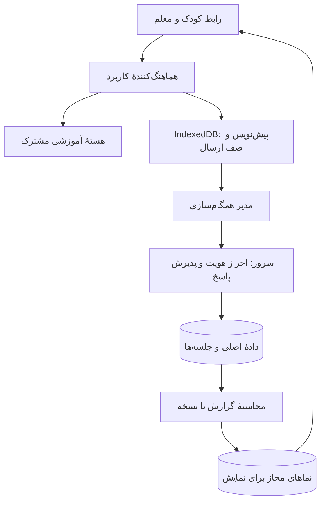

# معماری جامع نسخهٔ ۹ کارگاه ضرب

> وضعیت: طرح پیشنهادی آمادهٔ بررسی و برنامه‌ریزی اجرا؛ این سند به معنی پیاده‌سازی یا تأیید امنیت نسخهٔ ۹ نیست.
>
> تاریخ تدوین: ۲۰۲۶/۱۰/۱۶ — نسخهٔ سند: ۱.۰ — مبنای کد: نسخهٔ ۸.۱
>
> مخاطبان: مالک محصول، معلم، توسعه‌دهنده و آزمونگر.

## ۱. هدف و تصمیم اصلی

نسخهٔ ۹ باید تمرین ضرب را برای کودک ساده نگه دارد و برای معلم، سابقهٔ قابل اعتماد از یادگیری بسازد. اولویت با حفظ پاسخ‌ها، تشخیص درست دانش‌آموز، جداسازی اطلاعات کلاس‌ها و ادامهٔ کار هنگام قطع اینترنت است.

معماری پیشنهادی یک برنامهٔ وب ماژولار، یک پایگاه دادهٔ اصلی، ذخیره‌سازی محلی در مرورگر و یک بخش کوچک سمت سرور دارد. هستهٔ آموزشی فعلی حفظ و به‌تدریج مستقل می‌شود. بازنویسی کامل رابط، چند سرویس مستقل و افزودن چارچوب سنگین جزو نیازهای نسخهٔ ۹ نیست.

سه اصل حاکم:

1. پاسخ پذیرفته‌شده، منبع حقیقت است؛ امتیاز و گزارش از آن محاسبه می‌شوند.
2. هویت دانش‌آموز از مرورگر، دستگاه و کد ورود به کلاس مستقل است.
3. نتیجهٔ محلی می‌تواند فوری باشد؛ نتیجهٔ نهایی کلاس پس از پذیرش سرور معتبر است.

## ۲. مبنا و محدودیت‌های شناخته‌شدهٔ نسخهٔ ۸.۱

این موارد بر اساس فایل‌های مخزن هنگام تدوین سند ثبت شده‌اند؛ وضعیت قوانین محیط عملیاتی باید جداگانه بررسی شود.

| بخش | وضعیت مبنا | تغییر موردنیاز |
|---|---|---|
| آموزش | منطق تسلط و زمان پاسخ در هسته وجود دارد | حفظ رفتار و افزودن قرارداد و نسخهٔ قواعد |
| هویت | شناسهٔ بازیکن در حافظهٔ مرورگر است | شناسهٔ مستقل دانش‌آموز و بازیابی کنترل‌شده |
| کلاس | اطلاعات کلاس محلی و کد کلاس زنده هم‌زمان وجود دارند | یک مدل کلاس و عضویت |
| امتیاز | مرورگر مستقیماً امتیاز نهایی را می‌نویسد | ارسال پاسخ و محاسبهٔ نتیجه در سرور |
| سابقه | نتیجهٔ سکتور جدید جای امتیاز قبلی را می‌گیرد | نگهداری جلسه‌ها و پاسخ‌های مجزا |
| آفلاین | صف پایدار ارسال پاسخ وجود ندارد | IndexedDB و صف ارسال با رسید |
| مجوزها | قوانین Firebase در مخزن مدیریت نشده‌اند | قوانین نسخه‌دار و آزمون دسترسی |
| آزمون | آزمون منطق آموزشی و اتصال شبیه‌سازی‌شده موجود است | حفظ آن‌ها و افزودن آزمون امنیت و دو دستگاه |

آزمون دو اتصال شبکه با Firebase، جای آزمون کامل دو دستگاه و مشاهدهٔ رابط را نمی‌گیرد. این سند چنین تأییدی را مفروض نمی‌گیرد.

## ۳. بازار هدف و معیار تناسب محصول

کاربر اصلی کودک فارسی‌زبان دبستانی و کاربر مدیریتی معلم است. تلفن اقتصادی، اینترنت ناپایدار و دستگاه مشترک باید در طراحی لحاظ شوند. این‌ها فرض طراحی‌اند و باید با کاربران واقعی ارزیابی شوند.

| مخاطب | نیاز | پاسخ محصول |
|---|---|---|
| دانش‌آموز | ورود ساده و تمرین بدون سردرگمی | مسیر کوتاه ورود، پیام فارسی، ادامهٔ تمرین |
| معلم | شناخت مشکل یادگیری و کنترل کلاس | گزارش قابل توضیح، عضویت روشن و تکلیف هدفمند |
| خانواده | آگاهی از پیشرفت بدون مقایسهٔ آسیب‌زا | گزارش محدود و با اجازهٔ معلم در مرحلهٔ بعد |
| مدرسه | حفاظت از داده و قابلیت نگهداری | دسترسی محدود، پشتیبان و مسیر بازیابی |

برای ورود دانش‌آموز، ایمیل و شمارهٔ تلفن لازم نیست. نام مستعار کافی است. دادهٔ اضافی مانند نشانی، تاریخ تولد دقیق، تصویر و موقعیت جغرافیایی جمع‌آوری نمی‌شود مگر نیاز مشخص و تأییدشده‌ای ایجاد شود.

رتبه‌بندی پیش‌فرض خاموش است. پیشرفت شخصی و رسیدن به تسلط، معیار اصلی تجربهٔ کودک است.

## ۴. دامنه و ترتیب عرضه

| انتشار | قابلیت‌های اصلی | شرط عبور |
|---|---|---|
| ۹.۰ | هویت و کلاس یکپارچه، تاریخچه، صف آفلاین، پذیرش پاسخ در سرور، دسترسی امن | قبولی آزمون‌های حیاتی این سند |
| ۹.۱ | تکلیف شخصی‌سازی‌شده، گزارش رشد و نمای زندهٔ معلم | قابل اعتماد بودن سابقه و قواعد آموزشی |
| ۹.۲ | گزارش خانواده، نصب‌پذیری و تکمیل آفلاین | تأیید حریم خصوصی و آزمون کش و به‌روزرسانی |

تمرین آفلاین پس از بارگذاری برنامه در ۹.۰ لازم است. بازشدن برنامه از حالت بسته بدون اینترنت، به کش پوستهٔ برنامه نیاز دارد و تا اجرای آن نباید وعده داده شود.

افزودن تقسیم، بازی جدید، چت، شبکهٔ اجتماعی، پرداخت و هوش مصنوعی مولد خارج از دامنهٔ اولیه است.

## ۵. نمای سه لایه

| لایه | پرسش اصلی | اجزای آن |
|---|---|---|
| مفهومی | چه کسی، چه کاری، با چه قاعده‌ای انجام می‌دهد؟ | هویت، کلاس، تمرین، تسلط، تکلیف و گزارش |
| داده | چه چیزی ذخیره می‌شود و کدام رکورد معتبر است؟ | عضویت، جلسه، پاسخ، رسید و نماهای محاسبه‌شده |
| فنی | این قواعد چگونه اجرا و حفاظت می‌شوند؟ | رابط، هسته، مخزن داده، IndexedDB، سرور و Firebase |



فلش بازگشت داده به رابط، مجوز نوشتن مستقیم نتیجهٔ نهایی را به مرورگر نمی‌دهد.

## ۶. لایهٔ مفهومی

### ۶.۱ نقش‌ها و اختیارها

| نقش | اختیار |
|---|---|
| معلم مالک | ایجاد کلاس، عضویت، تکلیف، گزارش و مدیریت دعوت |
| دانش‌آموز | تمرین، دیدن پیشرفت خود و ارسال پاسخ جلسهٔ مجاز |
| خانواده، در مرحلهٔ بعد | فقط گزارش همان کودک با دسترسی قابل لغو |
| پشتیبان فنی | پیش‌فرض بدون دسترسی به محتوای آموزشی؛ دسترسی استثنایی ثبت‌شده |

نقش معلم از انتخاب یک دکمه، پین محلی یا مقدار ارسالی مرورگر ایجاد نمی‌شود. نقش و مالکیت در سمت سرور تعیین می‌شوند.

### ۶.۲ مفاهیم اصلی

- **دانش‌آموز:** صاحب پروندهٔ آموزشی با شناسهٔ ثابت.
- **دستگاه:** مرورگر مجاز برای استفاده از یک یا چند پرونده؛ صاحب پرونده نیست.
- **کلاس:** مجموعه‌ای با مالک، اعضا، سیاست نمایش و وضعیت فعال یا بایگانی.
- **دعوت:** اجازهٔ موقت درخواست عضویت؛ کد دعوت مجوز مشاهدهٔ اطلاعات کلاس نیست.
- **جلسه:** یک نوبت تمرین با فهرست سؤال و قواعد مشخص؛ «سکتور» فعلی می‌تواند به یک جلسه نگاشت شود.
- **پاسخ:** رویداد ثبت انتخاب کودک برای یک سؤال مشخص.
- **تسلط:** برآورد آموزشی بر اساس پاسخ‌های پذیرفته‌شده و نسخهٔ مشخص قواعد.
- **تکلیف:** انتخاب هدف آموزشی، دامنهٔ تمرین و زمان‌بندی توسط معلم.
- **گزارش:** نمای قابل بازسازی از دادهٔ اصلی، همراه نسخه و زمان محاسبه.

### ۶.۳ قواعد تغییرناپذیر کسب‌وکار

1. دو کودک هم‌نام، دو پروندهٔ مستقل دارند.
2. یک کودک در دو دستگاه باید با فرایند بازیابی یا اتصال تأییدشده به همان پرونده برسد.
3. ورود به کلاس جدید، تاریخچهٔ کلاس قبلی را حذف نمی‌کند.
4. ارسال مجدد یک پاسخ، امتیاز تازه ایجاد نمی‌کند.
5. پایان جلسه پس از پذیرش پاسخ‌های لازم قطعی می‌شود.
6. تغییر قواعد آموزشی، دادهٔ خام قبلی را تغییر نمی‌دهد.
7. کودک اطلاعات خصوصی هم‌کلاسی‌ها را نمی‌بیند.
8. رتبه‌بندی تنها بر اساس جلسه‌های قابل مقایسه و سیاست مشخص معلم ساخته می‌شود.
9. سرعت پاسخ به‌تنهایی نشانهٔ تسلط نیست؛ دقت، تکرار و شرایط پاسخ نیز لحاظ می‌شوند.
10. نتیجهٔ قدیمی واردشده از نسخهٔ قبل، برچسب «سابقهٔ قدیمی، تأییدنشده» دارد.

### ۶.۴ مسیرهای اصلی کاربر

**معلم:** ورود معتبر ← ایجاد کلاس ← صدور دعوت ← تأیید یا مدیریت اعضا ← تعیین تمرین ← دیدن وضعیت ارسال و گزارش.

**دانش‌آموز جدید:** دعوت معتبر ← نام نمایشی ← ایجاد پرونده یا درخواست عضویت ← تمرین ← نتیجهٔ محلی ← تأیید ذخیرهٔ ابری.

**دانش‌آموز در دستگاه دیگر:** دریافت مجوز اتصال از معلم ← اتصال به پروندهٔ موجود ← دریافت وضعیت معتبر ← ادامهٔ تمرین.

**دستگاه مشترک:** انتخاب پروندهٔ مجاز ← تمرین ← خروج از پرونده و پاک‌شدن نمای قبلی از رابط. تغییر ظاهر پروفایل به‌تنهایی حفاظت امنیتی ایجاد نمی‌کند.

## ۷. لایهٔ داده

### ۷.۱ شناسه و نسخه

شناسه‌های `studentId`، `classId`، `sessionId` و `eventId` تصادفی و فاقد نام یا شمارهٔ تماس‌اند. کد شش‌رقمی، شناسهٔ اصلی کلاس نیست.

هر رکورد پایدار `schemaVersion` دارد. جلسه همچنین `rulesVersion`، `questionSetVersion` و `appVersion` دارد. نسخهٔ برنامه جای نسخهٔ ساختار داده یا قواعد آموزشی را نمی‌گیرد.

### ۷.۲ موجودیت‌ها

| موجودیت | فیلدهای مهم | مرجع تغییر |
|---|---|---|
| کاربر | uid، نقش، وضعیت حساب | سرور و احراز هویت |
| دانش‌آموز | studentId، نام نمایشی، وضعیت | سرور با اختیار معلم یا عضویت معتبر |
| مجوز دستگاه | uid، studentId، دامنهٔ اختیار، وضعیت لغو | سرور |
| کلاس | classId، ownerUid، نام، وضعیت، سیاست گزارش | معلم از API |
| عضویت | classId، studentId، وضعیت و زمان عضویت | سرور |
| دعوت | توکن امن، انقضا، سقف مصرف، وضعیت | سرور |
| تکلیف | هدف، سؤال‌های مجاز، موعد، قواعد | معلم از API |
| جلسه | هویت، سؤال‌ها، وضعیت، نسخه و مالک اجرای فعال | سرور |
| پاسخ پذیرفته‌شده | eventId، questionId، پاسخ و زمان‌ها | سرور پس از اعتبارسنجی |
| رسید | شناسهٔ درخواست، وضعیت و نسخهٔ ثبت | سرور |
| وضعیت یادگیری | سطح تسلط و شواهد خلاصه | پردازش محاسباتی |
| گزارش | آمار و revision منبع | پردازش محاسباتی |

### ۷.۳ مسیرهای پیشنهادی RTDB

```text
/v9/users/{uid}
/v9/userClassAccess/{uid}/{classId}
/v9/deviceStudentAccess/{uid}/{studentId}
/v9/students/{studentId}
/v9/classrooms/{classId}
/v9/memberships/{classId}/{studentId}
/v9/invites/{inviteId}
/v9/assignments/{classId}/{assignmentId}
/v9/sessionLedgers/{classId}/{studentId}/{sessionId}
/v9/studentSessionIndex/{classId}/{studentId}/{sessionId}
/v9/learningState/{classId}/{studentId}
/v9/teacherViews/{classId}/{studentId}
/v9/studentViews/{studentId}/{classId}
/v9/leaderboards/{classId}/{periodId}/{entryId}
/v9/audit/{classId}/{auditId}
```

`sessionLedgers` دفتر اصلی جلسه است و تعریف سؤال‌ها، پاسخ‌های پذیرفته‌شده، وضعیت و revision را در محدوده‌ای کوچک نگه می‌دارد. تراکنش پذیرش پاسخ فقط همین جلسه را قفل می‌کند؛ روی ریشهٔ کلاس یا کل دیتابیس تراکنش اجرا نمی‌شود.

اندازه و تعداد سؤال‌های هر جلسه محدود است. جلسهٔ طولانی به چند جلسهٔ مرتبط تقسیم می‌شود. حد اولیهٔ پیشنهادی ۵۰ پاسخ و حداکثر ۲۵۶ کیلوبایت دادهٔ معتبر برای یک جلسه است؛ این اعداد باید با اندازهٔ واقعی داده سنجیده شوند.

مسیرهای گزارش و فهرست، دادهٔ مشتق‌شده‌اند؛ در صورت خرابی باید قابل بازسازی باشند. درخواست فهرست‌ها صفحه‌بندی و شاخص‌گذاری می‌شود و شنوندهٔ زنده روی کل `/v9` نصب نمی‌شود.

### ۷.۴ نمونهٔ پاسخ ارسالی

```json
{
  "schemaVersion": 1,
  "eventId": "random-event-id",
  "sessionId": "random-session-id",
  "classId": "random-class-id",
  "studentId": "random-student-id",
  "questionId": "q-03",
  "answer": 24,
  "responseMs": 3800,
  "clientOccurredAt": "2026-10-16T08:30:00Z",
  "writerEpoch": 1
}
```

مرورگر `score`، `mastery`، `acceptedAt` یا نقش کاربر را تعیین نمی‌کند. سرور عملوندها و پاسخ درست را از تعریف جلسه می‌خواند. `responseMs` و ساعت دستگاه دادهٔ گزارش‌شده از مشتری‌اند و به‌تنهایی قابل اعتماد نیستند.

### ۷.۵ زمان، ترتیب و سازگاری

- `clientOccurredAt`: زمان اعلام‌شدهٔ دستگاه، برای کمک به نمایش و عیب‌یابی.
- `acceptedAt`: زمان سرور برای ثبت پذیرش.
- `sequence`: ترتیب سؤال یا پاسخ طبق قرارداد جلسه.
- `revision`: شمارندهٔ تغییر دادهٔ معتبر.
- `sourceRevision`: نسخهٔ داده‌ای که یک گزارش از آن ساخته شده است.

گزارش قدیمی اجازه ندارد گزارش جدیدتر را بازنویسی کند. خروجی محاسبه باید با مقایسهٔ نسخه و تراکنش منتشر شود. برای خلاصهٔ چندجلسه‌ای، کار پردازش برای همان دانش‌آموز/کلاس هماهنگ می‌شود و در صورت تغییر ورودی پیش از انتشار، محاسبه تکرار می‌شود.

### ۷.۶ حذف و نگهداری

بایگانی کلاس با حذف پرونده فرق دارد. حذف واقعی باید درخواست مشخص، کنترل اختیار، ثبت رویداد و تعیین تکلیف پشتیبان‌ها داشته باشد. مدت نگهداری پاسخ خام، گزارش و رخدادهای فنی پیش از انتشار عمومی تعیین می‌شود؛ این سند مدت حقوقی قطعی تعیین نمی‌کند.

## ۸. لایهٔ فنی

### ۸.۱ اجزای پیشنهادی

| جزء | انتخاب پیشنهادی | دلیل |
|---|---|---|
| رابط | HTML/CSS/JavaScript ماژولار | حفظ سرمایهٔ فعلی و بارگذاری سبک |
| ساخت | ابزار کوچک مانند Vite، با نسخهٔ قفل‌شده | خروجی تولید و مدیریت وابستگی |
| هسته | توابع خالص مشترک در مرورگر و سرور | یکسانی محاسبات و قابلیت آزمون |
| ذخیرهٔ محلی | IndexedDB | نگهداری تراکنشی پاسخ و صف |
| هویت | Firebase Authentication | هویت قابل بررسی سمت سرور |
| دادهٔ ابری | Firebase Realtime Database | حفظ زیرساخت فعلی و نمای زنده |
| منطق مورد اعتماد | توابع محدود سمت سرور | بررسی عضویت، ثبت پاسخ و محاسبه |
| میزبانی رابط | GitHub Pages در صورت کفایت | حفظ مسیر انتشار فعلی |
| قواعد و آزمون سرور | Firebase Emulator Suite | آزمون مجاز و غیرمجاز قبل از انتشار |

انتخاب نهایی ابزار و نسخهٔ وابستگی هنگام اجرا با سازگاری محیط بررسی می‌شود. SDK فعلی به API ماژولار به‌تدریج منتقل می‌شود؛ صرف تعویض شمارهٔ نسخه، هدف معماری نیست.

برای Cloud Functions، امکان فعال‌سازی صورتحساب و هزینه باید پیش از انتخاب نهایی تأیید شود. در صورت ناممکن بودن، یک سرور جایگزین با همان قراردادها لازم است. حذف سرور و اعتماد به امتیاز مرورگر، جایگزین قابل قبول برای نتایج معتبر کلاس نیست.

### ۸.۲ ساختار پوشهٔ هدف

```text
src/
  core/                 # قواعد خالص آموزشی و قراردادهای مشترک
  application/          # مسیرهای کاربرد، جلسه و تکلیف
  data/
    local/              # IndexedDB و مهاجرت محلی
    remote/             # API و خواندن نماهای Firebase
    sync/               # صف، رسید، تلاش مجدد و تعارض
  identity/             # نشست ورود و انتخاب پرونده
  ui/                   # رابط کودک و معلم
  games/                # بازی‌ها با اتصال مشخص به application
server/
  api/                  # ورود، کلاس، جلسه و ثبت پاسخ
  authorization/        # نقش، عضویت و مجوز دستگاه
  projections/          # گزارش و تسلط قابل بازسازی
firebase/
  database.rules.json
tests/
  unit/
  integration/
  rules/
  acceptance/
docs/
```

این ساختار هدف است؛ جابه‌جایی همهٔ فایل‌ها در یک تغییر لازم نیست. ماژول core نباید به DOM، Firebase یا فضای ذخیره‌سازی وابسته باشد. رابط از طریق application و قرارداد مخزن داده کار می‌کند.

### ۸.۳ قرارداد API

| عملیات | ورودی اصلی | نتیجه و کنترل |
|---|---|---|
| createClass | نام و سیاست کلاس | ایجاد با مالک معتبر |
| issueInvite | classId و محدودیت دعوت | توکن منقضی‌شونده با کنترل مالکیت |
| redeemInvite | توکن و درخواست عضویت | عضویت یا درخواست تأیید؛ بدون افشای اعضا |
| grantDeviceAccess | دانش‌آموز و مجوز یک‌بارمصرف | اتصال دستگاه به پروندهٔ موجود |
| startSession | classId، studentId، هدف | تعریف جلسه و قواعد ثابت |
| submitAttempts | sessionId و پاسخ‌ها | رسید مستقل هر پاسخ |
| finalizeSession | sessionId و آخرین revision | پایان معتبر یا فهرست پاسخ‌های ناقص |
| transferSession | sessionId و درخواست انتقال | افزایش writerEpoch و لغو نویسندهٔ قبلی |
| getSyncStatus | sessionId | وضعیت معتبر و پاسخ‌های پذیرفته‌شده |

هر عملیات تغییردهنده `requestId` دارد. تکرار همان درخواست نباید ایجاد دوبارهٔ کلاس، دعوت یا جلسه کند. فهرست و جزئیات فقط با مجوز مناسب قابل خواندن‌اند.

برای خطاها از کدهای ثابت مانند `UNAUTHENTICATED`، `FORBIDDEN`، `INVITE_EXPIRED`، `INVALID_PAYLOAD`، `EVENT_CONFLICT`، `STALE_WRITER`، `RATE_LIMITED` و `TEMPORARILY_UNAVAILABLE` استفاده می‌شود. رابط پیام فارسی مناسب را نمایش می‌دهد.

## ۹. هویت، ورود و دستگاه مشترک

معلم با روش احراز هویت قابل بازیابی وارد می‌شود. روش دقیق ورود با توجه به دسترسی واقعی کاربران به سرویس انتخاب و آزمایش می‌شود. پین قبلی معلم فقط می‌تواند قفل رابط محلی باشد و مجوز سرور ایجاد نمی‌کند.

برای کودک، احراز هویت دستگاه می‌تواند با حساب ناشناس Firebase آغاز شود، اما نگاشت آن حساب به پرونده باید توسط سرور و دعوت یا تأیید معلم انجام شود. حساب ناشناس پس از پاک‌شدن دادهٔ مرورگر، به‌خودی‌خود هویت همان کودک را بازیابی نمی‌کند.

اتصال دستگاه دوم با مجوز تصادفی، محدود، یک‌بارمصرف و قابل لغو انجام می‌شود. کد کوتاه فقط با انقضا، محدودیت تلاش و فرایند تأیید قابل استفاده است. نام کودک یا دانستن کد کلاس برای تصاحب پرونده کافی نیست.

در دستگاه مشترک، اگر یک هویت مرورگر به چند پرونده دسترسی داشته باشد، فرد مسلط به همان مرورگر ممکن است دادهٔ محلی آن پرونده‌ها را ببیند. قفل سادهٔ انتخاب پروفایل، تضمین محرمانگی در برابر صاحب دستگاه نیست. برای اطلاعات حساس معلم از نشست و محیط جدا استفاده می‌شود؛ دادهٔ کش‌شدهٔ کودک نیز حداقلی است.

## ۱۰. چرخهٔ جلسه، ارسال و جلوگیری از تکرار

### ۱۰.۱ وضعیت جلسه

```text
LOCAL_DRAFT -> ACTIVE -> FINALIZING -> FINALIZED
                    \-> ABANDONED
```

پیش‌نویس محلی تا زمان ایجاد جلسه در سرور، نتیجهٔ معتبر کلاسی ندارد. تمرین آزادِ کاملاً آفلاین مجاز است، اما جدا از نتیجهٔ تأییدشده گزارش می‌شود. انتقال پیش‌نویس به جلسهٔ سرور فقط پس از بررسی تعریف سؤال و قواعد انجام می‌شود.

### ۱۰.۲ پذیرش پاسخ در سرور

1. توکن هویت، عضویت فعال و مجوز پرونده بررسی می‌شود.
2. جلسه، نسخهٔ قواعد، سؤال، وضعیت و `writerEpoch` بررسی می‌شود.
3. شکل، نوع، طول و اندازهٔ ورودی محدود می‌شود.
4. روی دفتر همان جلسه تراکنش اجرا می‌شود.
5. `eventId` تازه ثبت و نتیجه با هستهٔ مشترک محاسبه می‌شود.
6. شناسهٔ تکراری با محتوای یکسان، همان رسید قبلی را دریافت می‌کند.
7. شناسهٔ تکراری با محتوای متفاوت، تعارض است و پاسخ قبلی تغییر نمی‌کند.
8. پس از ثبت پایدار، رسید شامل شناسه و revision برگردانده می‌شود.
9. نماهای گزارش به‌صورت قابل تکرار و با کنترل نسخه به‌روز می‌شوند.

این رفتار «اثر یک‌باره» ایجاد می‌کند، حتی اگر شبکه درخواست را چند بار بفرستد. ترتیب یا تعداد تحویل پیام در شبکه تضمین‌شده فرض نمی‌شود.

### ۱۰.۳ پایان و دو دستگاه

پایان جلسه فقط پس از رسیدن پاسخ‌های لازم و تراکنش معتبر انجام می‌شود. دوباره‌زدن دکمهٔ پایان، پایان تازه یا امتیاز تازه نمی‌سازد.

یک جلسه در هر زمان یک نویسندهٔ فعال دارد. انتقال مالک اجرا با افزایش `writerEpoch` انجام می‌شود؛ پاسخ‌های دستگاه قبلی پس از انتقال در قرنطینهٔ محلی باقی می‌مانند و خودکار وارد نتیجهٔ جدید نمی‌شوند. معلم یا کاربر پیام روشن دریافت می‌کند. جلسهٔ مستقل هر دستگاه می‌تواند هم‌زمان فعال باشد.

سرور می‌تواند سازگاری پاسخ با سؤال را بررسی کند؛ اثبات اینکه کودک بدون کمک پاسخ داده یا زمان‌سنج مرورگر دست‌کاری نشده، با این معماری تضمین نمی‌شود. گزارش باید این محدودیت را رعایت کند.

## ۱۱. ذخیرهٔ آفلاین و همگام‌سازی

### ۱۱.۱ داده‌های محلی

IndexedDB شامل `profiles`، `sessionDrafts`، `attempts`، `outbox`، `receipts` و `migrationState` است. ثبت پاسخ و اضافه‌کردن آن به صف در یک تراکنش محلی انجام می‌شود. اگر این تراکنش شکست بخورد، رابط نباید پیام «ذخیره شد» نشان دهد.

### ۱۱.۲ وضعیت پاسخ در صف

```text
PENDING -> SENDING -> ACKNOWLEDGED
              |-> RETRY_WAIT -> PENDING
              |-> BLOCKED
              |-> CONFLICT
```

- خطای موقت شبکه: تلاش مجدد با فاصلهٔ افزایشی و پراکندگی زمانی.
- توکن منقضی: یک بار نوسازی نشست؛ سپس درخواست ورود در صورت شکست.
- عضویت لغوشده یا ورودی نامعتبر: توقف تکرار و نمایش راه‌حل؛ حذف خاموش ممنوع.
- تعارض: نگهداری نسخهٔ محلی برای بررسی و جلوگیری از بازنویسی بی‌اجازه.
- دریافت رسید: علامت‌گذاری و پاک‌سازی کنترل‌شدهٔ صف پس از ثبت رسید محلی.

بسته‌شدن صفحه، قطع اتصال پس از ثبت در سرور یا بازشدن دو تب نباید باعث امتیاز تکراری شود. یک هماهنگ‌کنندهٔ محلی بین تب‌ها کار می‌کند و اعتبارسنجی تکرار سمت سرور همچنان الزامی است.

ارسال در پس‌زمینه تضمین نمی‌شود؛ همگام‌سازی با بازشدن برنامه و برگشت اتصال ادامه می‌یابد. پرشدن فضا یا پاک‌کردن دادهٔ مرورگر ممکن است پاسخ‌های هنوز ارسال‌نشده را از بین ببرد؛ رابط باید وضعیت ذخیره و گزینهٔ خروجی گرفتن را روشن نشان دهد.

### ۱۱.۳ پیام‌های لازم برای کودک و معلم

| وضعیت | پیام نمونه |
|---|---|
| پاسخ فقط محلی است | «روی این دستگاه ذخیره شد؛ منتظر اینترنت» |
| سرور پذیرفته است | «در پروندهٔ تو ثبت شد» |
| ذخیرهٔ محلی شکست خورده | «ذخیره انجام نشد؛ این صفحه را نبند» |
| دسترسی لغو شده | «برای فرستادن پاسخ‌ها از معلم کمک بگیر» |
| گزارش عقب است | «پاسخ‌ها ثبت شده‌اند؛ گزارش در حال آماده‌شدن است» |

## ۱۲. امنیت و حریم خصوصی

### ۱۲.۱ مرز اعتماد

مرورگر محیط قابل اعتماد برای تعیین نقش، عضویت و نتیجه نیست. مخفی‌کردن دکمه یا نام فایل، کنترل دسترسی محسوب نمی‌شود. تنظیمات عمومی Firebase کلید خصوصی سرور نیستند؛ مجوز واقعی باید در احراز هویت، قوانین و API اجرا شود.

تمام نوشتن‌های اصلی نسخهٔ ۹ از API مورد اعتماد عبور می‌کنند. SDK مدیریتی سرور نیز باید در خود API کنترل اختیار انجام دهد. مرورگر تنها نماهای مجاز را می‌خواند؛ نوشتن مستقیم نمره، عضویت، نقش و گزارش رد می‌شود.

### ۱۲.۲ ماتریس دسترسی

| داده یا عمل | معلم مالک | دانش‌آموز مربوط | عضو دیگر کلاس | کاربر ناشناس بدون عضویت |
|---|---|---|---|---|
| جزئیات کلاس | مجاز | نمای محدود | نمای محدود | ممنوع |
| پاسخ‌های خصوصی کودک | مجاز | مطابق سیاست پروندهٔ خود | ممنوع | ممنوع |
| ثبت پاسخ | فقط مسیر دارای اختیار مشخص | جلسهٔ خود از API | ممنوع | ممنوع |
| نقش و عضویت | مدیریت از API | ممنوع | ممنوع | ممنوع |
| گزارش معلم | مجاز | ممنوع | ممنوع | ممنوع |
| جدول اختیاری نام مستعار | مجاز | در صورت فعال‌بودن | در صورت فعال‌بودن | ممنوع |
| حذف کلاس | فرایند تأییدشده از API | ممنوع | ممنوع | ممنوع |

قواعد از حالت پیش‌فرضِ منع دسترسی شروع می‌شوند. مجوز خواندن روی والد عمومی داده نمی‌شود؛ اعطای دسترسی در مسیر والد می‌تواند فرزندان را نیز در دسترس قرار دهد. قواعد خواندن، ابزار فیلترکردن یک فهرست خصوصی برای هر کاربر نیستند؛ نماهای جدا لازم‌اند.

### ۱۲.۳ تهدیدها و پاسخ

| تهدید | کنترل |
|---|---|
| حدس کد دعوت | انقضا، محدودیت تلاش و مصرف، پاسخ خطای غیر افشاگر |
| تغییر studentId یا classId در درخواست | بررسی اختیار روی هر درخواست |
| دست‌کاری امتیاز | محاسبه از سؤال و پاسخ در سرور |
| تکرار ارسال | eventId، requestId و تراکنش |
| اسکریپت در نام | نمایش متنی، اعتبارسنجی ورودی و سیاست محتوای مناسب |
| افشای اطلاعات در خطا | پیام عمومی در رابط و گزارش فنی پالایش‌شده |
| سوءاستفاده از API | محدودیت نرخ و اندازه؛ App Check در صورت امکان |
| وابستگی آسیب‌پذیر | نسخهٔ قفل‌شده، بررسی وابستگی و ارتقای کنترل‌شده |
| دسترسی پس از لغو عضویت | بررسی مجوز در سرور و قواعد؛ پایان شنونده‌ها |
| باقی‌ماندن داده روی دستگاه مشترک | کش حداقلی، خروج روشن و پاک‌سازی کنترل‌شده |

App Check جایگزین احراز هویت و مجوز نیست. هیچ رمز، کلید مدیریتی یا اعتبارنامهٔ سرویس در مخزن عمومی یا JavaScript مرورگر قرار نمی‌گیرد. دادهٔ واقعی دانش‌آموز در لاگ آزمون و نمونهٔ مستندات نوشته نمی‌شود.

این سند ادعای «صفر باگ» یا «صفر درز» ندارد. پیشگیری، آزمون منفی، پایش، اصلاح و برنامهٔ پاسخ به رخداد همگی لازم‌اند.

## ۱۳. قواعد آموزشی و گزارش

منطق موجود تسلط ابتدا بدون تغییر رفتاری به توابع خالص منتقل می‌شود. آزمون‌های فعلی مرجع جلوگیری از تغییر ناخواسته‌اند. تغییر آستانهٔ زمان یا تعداد تکرار، تغییر آموزشی جداگانه با نسخه و تأیید معلم است.

گزارش حداقل این موارد را نشان می‌دهد:

- دقت پاسخ و تعداد شواهد معتبر؛
- واقعیت‌های ضرب نیازمند مرور؛
- روند پیشرفت در چند جلسه؛
- تفکیک نتیجهٔ محلیِ منتظر ارسال، نتیجهٔ پذیرفته‌شده و سابقهٔ قدیمی؛
- زمان آخرین همگام‌سازی و نسخهٔ قواعد گزارش.

مقایسهٔ امتیاز دو جلسه با سؤال‌ها یا قواعد متفاوت مجاز نیست مگر روش مقایسه تعریف شده باشد. پاسخ‌های دیرهمگام‌شده باید در بازسازی گزارش لحاظ شوند و ساعت نادرست دستگاه نباید به‌تنهایی ترتیب آموزشی را تعیین کند.

توصیهٔ تکلیف در ۹.۱ با قواعد قابل توضیح آغاز می‌شود؛ برای مثال «مرور ضرب‌های ۶ به دلیل سه خطای اخیر». استفاده از هوش مصنوعی مولد برای این قابلیت لازم نیست.

## ۱۴. رابط، دسترس‌پذیری و سبک‌بودن

- رابط راست‌به‌چپ و پشتیبانی از ارقام فارسی، عربی و لاتین در ورودی عددی.
- پیام کوتاه و مناسب سن کودک، با راه‌حل روشن هنگام خطا.
- کنترل‌های لمسی با هدف طراحی حداقل ۴۴ در ۴۴ پیکسل CSS.
- استفاده با صفحه‌کلید، برچسب قابل خواندن و فوکوس قابل مشاهده.
- اتکا نکردن صرف به رنگ، صدا یا حرکت؛ امکان کاهش حرکت و قطع صدا.
- نمایش جداگانهٔ «اینترنت قطع است» و «ذخیره انجام نشد».
- بارگذاری کد پنل معلم فقط هنگام نیاز و حذف منابع غیرضروری.
- فونت و دارایی‌ها با درنظرگرفتن دسترسی شبکهٔ مخاطب میزبانی شوند.

بودجهٔ عملکرد اولیه، هدف آزمون است و اندازه‌گیری‌شده محسوب نمی‌شود:

| معیار | هدف اولیه |
|---|---|
| حجم JavaScript فشردهٔ مسیر اولیهٔ کودک | حداکثر ۲۵۰ کیلوبایت، بدون دارایی رسانه‌ای اختیاری |
| LCP در سناریوی موبایل منتخب | حداکثر ۲٫۵ ثانیه در شرایط آزمون توافق‌شده |
| INP در سناریوی آزمون | حداکثر ۲۰۰ میلی‌ثانیه |
| نمایش وضعیت ثبت محلی پاسخ | صدک ۹۵ حداکثر ۲۰۰ میلی‌ثانیه در دستگاه منتخب |
| بازتاب نتیجه بین دو دستگاه آنلاین | هدف صدک ۹۵ حداکثر ۵ ثانیه در شرایط شبکهٔ ثبت‌شده |

این اهداف پس از اندازه‌گیری مبنا بازبینی می‌شوند. رتبهٔ ابزار خودکار جای آزمون لمس، خوانایی فارسی و استفادهٔ کودک را نمی‌گیرد.

## ۱۵. هزینه، عملیات و محیط‌ها

توسعه، آزمایش و تولید از داده و تنظیمات جدا استفاده می‌کنند. آزمون خودکار هرگز روی کلاس واقعی اجرا نمی‌شود. آزمون پذیرش تولید فقط با کلاس آزمایشی مشخص و دادهٔ ساختگی انجام می‌شود.

گزارش‌های کوچک زنده‌اند؛ تاریخچه صفحه‌بندی می‌شود. شنونده‌های صفحه با خروج بسته می‌شوند. سقف اندازهٔ ورودی، نرخ API، حجم لاگ و نگهداری داده تعیین می‌شود.

هشدار هزینه، سقف قطعی صورت‌حساب نیست. پیش از عرضه، برآورد هزینه بر اساس تعداد کلاس، دانش‌آموز، پاسخ روزانه، دانلود و فراخوانی سرور ثبت می‌شود. محدودیت سوءاستفاده و برنامهٔ توقف قابلیت پرهزینه لازم است.

لاگ فنی شامل کد خطا، شناسهٔ درخواست، نسخهٔ برنامه و زمان است. نام کودک، پاسخ‌های کامل، رمز و توکن در لاگ عادی قرار نمی‌گیرند. شاخص‌های عملیاتی شامل خطای پذیرش، سن قدیمی‌ترین پاسخ صف، تأخیر گزارش و خطای دسترسی‌اند.

## ۱۶. مهاجرت از نسخهٔ ۸.۱

### ۱۶.۱ دادهٔ قابل مهاجرت

نام نمایشی، تنظیمات مجاز و سوابق آموزشی موجود پس از اعتبارسنجی می‌توانند منتقل شوند. امتیازهایی که قبلاً بازنویسی شده‌اند قابل بازسازی نیستند. شناسه‌های محلی و کد کلاس قدیمی به‌تنهایی مالکیت پرونده را ثابت نمی‌کنند.

### ۱۶.۲ ترتیب مهاجرت

1. ثبت نسخهٔ مبنا و تهیهٔ خروجی قابل بازیابی از دادهٔ محلی و دادهٔ ابری مجاز.
2. بررسی کیفیت و حجم داده و اجرای آزمایشی مهاجرت بدون نوشتن تولید.
3. ساخت کلاس و پروندهٔ جدید با تأیید مالک؛ تطبیق با نام به‌تنهایی ممنوع.
4. نگهداری نگاشت شناسهٔ قدیم به جدید همراه منشأ و وضعیت تأیید.
5. ورود سابقه با برچسب legacy و اعتماد محدود؛ جدا از پاسخ‌های تأییدشدهٔ جدید.
6. اجرای کوچک برای یک کلاس و مقایسهٔ گزارش قبل و بعد.
7. انتقال کلاس‌های بعدی پس از قبولی؛ نگهداری گزارش مهاجرت و امکان تکرار بدون تکثیر.
8. بستن مسیرهای نوشتن عمومی قدیمی پس از قطع وابستگی نسخه‌های فعال.

نوشتن هم‌زمان و مستقل در دو مدل قدیم و جدید ممنوع است. هر کلاس در زمان مشخص یک مدل اصلی دارد. اگر سازگاری موقت لازم باشد، دادهٔ قدیمی از مدل اصلی جدید مشتق می‌شود و مرجع دوم نمی‌سازد.

### ۱۶.۳ بازگشت امن

بازگرداندن فایل‌های رابط، دادهٔ جدید را خودکار به مدل قدیم تبدیل نمی‌کند. در خرابی، پذیرش جدید برای کلاس آزمایشی متوقف، داده حفظ و نسخهٔ سالمِ سازگار با همان ساختار منتشر می‌شود. بازکردن قواعد امنیتی قدیمی روش بازگشت نیست. پشتیبان باید در محیط جدا بازیابی و بررسی شود.

## ۱۷. برنامهٔ اجرای مرحله‌ای

| مرحله | خروجی قابل بررسی | پیش‌نیاز اتمام |
|---|---|---|
| ۰. مبنا | فهرست رفتار فعلی، آزمون‌ها و اندازه‌گیری | اجرای آزمون‌های فعلی و ثبت محدودیت‌ها |
| ۱. قرارداد | شناسه‌ها، ساختار داده، API و قواعد آموزشی | توافق بر نمونه‌های ورودی و خطا |
| ۲. هسته | ماژول مشترک بدون وابستگی محیطی | برابری نتیجهٔ مرورگر و سرور |
| ۳. هویت و کلاس | ورود معلم، عضویت و بازیابی دانش‌آموز | قبولی آزمون منع دسترسی |
| ۴. ثبت پاسخ | جلسه، دفتر پاسخ و رسید | ارسال تکراری بدون اثر اضافه |
| ۵. آفلاین | صف پایدار و رابط وضعیت | بستن و بازکردن صفحه بدون گم‌شدن صف |
| ۶. گزارش | نماهای نسخه‌دار و تاریخچه | بازسازی و سازگاری دو دستگاه |
| ۷. مهاجرت | ابزار آزمایشی و گزارش تطبیق | بازیابی پشتیبان و اجرای یک کلاس |
| ۸. انتشار | بستهٔ تولید و راهنمای معلم | قبولی همهٔ دروازه‌های انتشار |

هر مرحله کوچک و قابل بازبینی اجرا می‌شود. انتشار کد رابط و فعال‌سازی قابلیت برای همهٔ کلاس‌ها دو تصمیم جدا هستند. زمان و هزینهٔ اجرا پس از تعیین روش ورود، صورتحساب و حجم داده برآورد می‌شود.

## ۱۸. ماتریس آزمون و دروازهٔ انتشار

| حوزه | سناریوی ضروری | نتیجهٔ مورد انتظار |
|---|---|---|
| آموزش | مجموعهٔ نمونه‌های فعلی تسلط | رفتار حفظ شود یا تغییر مصوب و نسخه‌دار باشد |
| هویت | دو کودک هم‌نام | پرونده‌ها مستقل بمانند |
| بازیابی | کودک در دستگاه دوم | اتصال به همان پرونده با مجوز معتبر |
| امنیت | تغییر classId/studentId | رد درخواست و عدم افشای داده |
| قواعد | درخواست مستقیم به RTDB/REST | نوشتن نتیجه و خواندن خصوصی رد شود |
| دعوت | منقضی، حدس متوالی و مصرف دوباره | رد یا محدودسازی طبق سیاست |
| تکرار | ارسال یک eventId چند بار | فقط یک اثر آموزشی |
| تعارض | همان eventId با پاسخ متفاوت | خطای تعارض و حفظ اصل پاسخ |
| شبکه | سرور ثبت کند، رسید به مشتری نرسد | ارسال دوباره همان رسید را برگرداند |
| آفلاین | پاسخ، بستن صفحه، بازکردن و اتصال | حفظ صف و همگام‌سازی |
| فضای محلی | پرشدن یا ممنوع‌بودن ذخیره | هشدار روشن، بدون ادعای ذخیره |
| چند تب | دو تب صف را ارسال کنند | بدون اثر تکراری |
| چند دستگاه | انتقال جلسه و ارسال دستگاه قدیمی | رد نویسندهٔ قدیمی و حفظ پاسخ محلی |
| گزارش | پردازش قدیمی پس از پردازش جدید برسد | گزارش جدید عقب نرود |
| لغو عضویت | پاسخ معوق پس از لغو ارسال شود | رد با پیام روشن، بدون تکرار بی‌پایان |
| رابط | موبایل کوچک، RTL، صفحه‌کلید و لمس | مسیر اصلی قابل استفاده باشد |
| دسترسی شبکه | شبکهٔ واقعی مخاطب بدون VPN | ورود، ذخیره و بازیابی آزمایش شود |
| مهاجرت | اجرای دوبارهٔ همان ورودی | بدون تکثیر پرونده یا سابقه |
| پشتیبان | بازیابی در محیط جدا | تطابق تعداد و نمونهٔ سوابق |
| تولید | دو دستگاه فیزیکی و Firebase واقعی | ثبت، نمایش و به‌روزرسانی صحیح |

آزمون‌های فعلی `node tests/run-mastery.js` و `node --test tests/live-board.test.js` در دورهٔ گذار حفظ می‌شوند. آزمون‌های جدید باید رفتار و مرز اعتماد را بررسی کنند، نه فقط شکل داخلی پیاده‌سازی را.

انتشار عمومی مشروط است به: قبولی همهٔ سناریوهای حیاتی، نبود خطای شناخته‌شدهٔ از دست‌رفتن پاسخ یا افشای پرونده، آزمون دو دستگاه واقعی، بازیابی موفق پشتیبان، تعیین هزینه و تأیید مسیر استفاده توسط معلم. عبور از این دروازه‌ها تضمین نبود همهٔ باگ‌ها نیست.

## ۱۹. تصمیم‌های باز پیش از اجرای تولید

| تصمیم | پیشنهاد اولیه | شرط نهایی‌شدن |
|---|---|---|
| ورود معلم | روش Firebase قابل بازیابی | آزمایش دسترسی واقعی و بازیابی حساب |
| صورتحساب سرور | بررسی Cloud Functions یا سرور جایگزین | امکان پرداخت و برآورد هزینه |
| عضویت دانش‌آموز | دعوت با تأیید معلم یا سیاست کلاس | تعیین سادگی و ریسک کلاس هدف |
| اتصال دستگاه دوم | مجوز محدود صادرشده توسط معلم | آزمون روی دستگاه مشترک و مستقل |
| نگهداری داده | حداقل لازم برای هدف آموزشی | سیاست مدرسه و الزامات قابل اعمال |
| رتبه‌بندی | خاموش به‌صورت پیش‌فرض | تأیید آموزشی و حریم خصوصی |
| ادامهٔ آفلاین از شروع سرد | عرضه پس از آزمون کش | سیاست به‌روزرسانی و پاک‌سازی |
| اهداف عملکرد و سقف کلاس | اعداد پیشنهادی این سند | اندازه‌گیری بار واقعی |

این تصمیم‌ها مانع آماده‌بودن طرح برای توسعه نیستند؛ فعال‌سازی قابلیت وابسته در تولید تا تعیین آن‌ها انجام نمی‌شود.

## ۲۰. چک‌لیست پایان نسخهٔ ۹.۰

- [ ] هویت، عضویت و کلاس تنها یک مرجع معتبر دارند.
- [ ] هستهٔ آموزشی مشترک و نسخه‌دار است.
- [ ] پاسخ‌ها با ثبت محلی تراکنشی و رسید سرور مدیریت می‌شوند.
- [ ] امتیاز و تسلط نهایی از دادهٔ پذیرفته‌شده محاسبه می‌شوند.
- [ ] ثبت تکراری و پردازش خارج از ترتیب آزموده شده‌اند.
- [ ] تاریخچه جایگزین‌نشدنی و گزارش قابل بازسازی وجود دارد.
- [ ] قواعد و API دسترسی غیرمجاز را در آزمون رد می‌کنند.
- [ ] حالت دستگاه مشترک و بازیابی پرونده روشن است.
- [ ] مهاجرت و بازیابی پشتیبان آزمایش شده‌اند.
- [ ] رابط فارسی روی دستگاه‌های هدف بررسی شده است.
- [ ] آزمون دو دستگاه فیزیکی با Firebase واقعی ثبت شده است.
- [ ] هزینه، نگهداری داده و پاسخ به رخداد مسئول مشخص دارند.
- [ ] راهنمای معلم، تغییرات نسخه و محدودیت‌های باقی‌مانده منتشر شده‌اند.

## ۲۱. مراجع و وضعیت اعتبارسنجی سند

مبنای داخلی این طرح: `README.md`، `docs/LIVE-LEADERBOARD.md`، `src/core/pedagogy.js`، `live-board.js` و آزمون‌های موجود مخزن است.

برای اجرا باید مستندات رسمی همان زمان دربارهٔ Firebase Authentication، قواعد Realtime Database، تراکنش‌ها، Emulator Suite، App Check، شرایط استقرار Cloud Functions، IndexedDB و WCAG بررسی شوند. نسخهٔ SDK، هزینه و شرایط سرویس در این سند ثابت یا تأییدشده فرض نشده‌اند.

این خروجی سند معماری است. به‌تنهایی کد، قوانین محیط زنده، صورتحساب، تنظیمات میزبانی یا نسخهٔ منتشرشده را تغییر نمی‌دهد.
