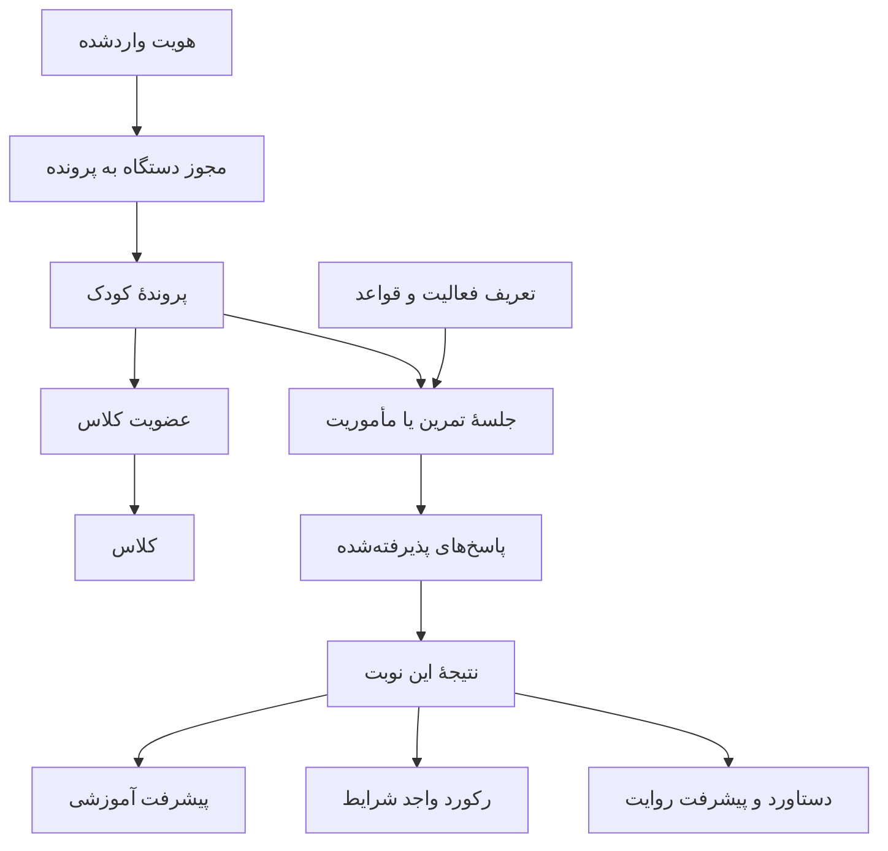
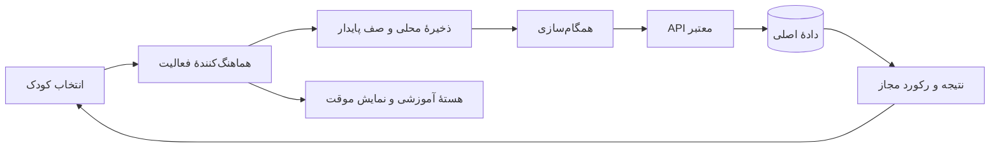

# معماری سه‌لایهٔ بازطراحی نسخهٔ ۹

نسخهٔ سند: پیش‌نویس ۱.۰ — تاریخ: ۲۰۲۶/۱۰/۱۶

این سند معماری تغییرات محصول است؛ اجرای تغییرات، استقرار API یا تغییر قرارداد قفل‌شده محسوب نمی‌شود. نسخهٔ منتشرشدهٔ بازی تا تکمیل و آزمون این طرح، ۸.۱ باقی می‌ماند.

## ۱. مبنا و حدود تصمیم‌ها

**تصمیم قطعی مالک:** نام کودک نخستین بار در صحنهٔ معرفی قهرمان در داستان ثبت می‌شود. سپس همان پرونده در همهٔ بخش‌ها استفاده می‌شود؛ ثبت نام تکراری نداریم.

**هدف اعلام‌شدهٔ مالک:** بازی متحرک، فعالیت جذاب با ثبت و ارسال نتیجه باشد. فعالیت انفرادی آموزشی، محل تمرین و یادگیری باشد.

**پیشنهادهای این سند:** خانهٔ چهارمقصدی کودک، نام «مأموریت نجات ایستگاه»، جایگاه مشترک گنجینه و قواعد تفکیک رکورد از پیشرفت. این پیشنهادها تا تصویب، تصمیم قفل‌شده نیستند.

اصول قرارداد قبلی حفظ می‌شوند: هویت معتبر معلم، سرور مورد اعتماد، عضویت فعال/منتظر مطابق سیاست کلاس، و خاموش‌بودن پیش‌فرض رتبه‌بندی عمومی. ثبت نتیجه در سرور با عمومی‌کردن آن متفاوت است.

مراجع داخلی:

- [معماری جامع قبلی](V9-ARCHITECTURE.fa.md)
- [قرارداد فاز یک](v9-phase1-contracts.md) و [تصمیم‌های قفل‌شده](v9-phase1-locked.md)
- [بازبینی ۴۲ موضوع تجربهٔ بازی](V9-GAME-EXPERIENCE-AUDIT.fa.md)
- [بازبینی مسیر ورود](V9-UI-ENTRY-REVIEW.fa.md)

## ۲. نمای سه لایه

| لایه | پرسش | نتیجهٔ مورد انتظار |
|---|---|---|
| مفهومی | کودک چه کسی است و هر بخش چه تجربه‌ای می‌دهد؟ | یک قهرمان، داستان پیوسته، تمرین و مأموریت با هدف روشن |
| داده | چه چیزی برای چه کسی و با چه معنایی ثبت می‌شود؟ | یک پرونده، جلسه‌های مستقل، پاسخ‌های معتبر و معیارهای جدا |
| فنی | چگونه این تجربه را ساده، قابل بازیابی و قابل اعتماد اجرا کنیم؟ | هماهنگ‌کنندهٔ ورود، هستهٔ مشترک، صف محلی و API معتبر |

## ۳. لایهٔ مفهومی: تجربه و قواعد محصول

### ۳.۱ جهان و نقش‌ها

- کودک قهرمان اصلی داستان و سازندهٔ ایستگاه است.
- نام داستانی، نام نمایشی او در بازی، کلاس و گزارش است؛ آواتار، تصویر انتخابی اوست.
- پهلوانان، یاران یا راهنمایان قهرمان‌اند. نقش دقیق روایی آنان و نام مجموعه پیش از ساخت صفحه‌ها تصویب شود.
- معلم فعالیت کلاس را مدیریت و پیشرفت مجاز را بررسی می‌کند؛ پنل او از انتخاب فعالیت کودک جداست.
- کلاس، محل عضویت و زمینهٔ فعالیت است؛ نوع بازی نیست. دوستان، زمینهٔ اجرای یک مأموریت‌اند؛ روش محاسبهٔ نمره نیستند.

نام محصول فعلی خودکار تغییر نمی‌کند. «مأموریت نجات ایستگاه» نام پیشنهادی بازی متحرک است و باید با هدف واقعی بازی و فهم کودک سنجیده شود.

### ۳.۲ اولین ورود و بازگشت

| موقعیت | مسیر |
|---|---|
| کودک تازه بدون دعوت | داستان ← معرفی و نام قهرمان ← آواتار اختیاری ← خانهٔ کودک |
| کودک تازه با دعوت معلم | شناسایی و نگهداری دعوت ← همان داستان و معرفی ← درخواست عضویت ← خانه/وضعیت کلاس |
| کودک بازگشتی | بازیابی پروندهٔ مجاز ← خوشامد با همان نام ← ادامهٔ فعالیت یا خانه |
| دستگاه مشترک | انتخاب کودک از پرونده‌های مجاز ← خانهٔ همان کودک |
| دستگاه دوم | بازیابی یا اتصال تأییدشده ← همان پرونده؛ بدون ساخت کودک تازه از روی نام |
| دعوت منقضی | حفظ پرونده و پیشرفت ← دریافت دعوت تازه برای همان کودک |

«رد کردن داستان» کودک تازه را به صحنهٔ معرفی می‌رساند. «بازپخش داستان» برای کودک شناخته‌شده ثبت نام تازه نمی‌سازد. تغییر نام، تغییر کودک، تغییر کلاس و خروج از حساب چهار اقدام مجزا هستند.

نام فقط یک بار برای ساخت پرونده پرسیده می‌شود؛ درخواست آگاهانهٔ ویرایش نام یا رفع تعارض مهاجرت، ثبت نام دوباره محسوب نمی‌شود.

### ۳.۳ خانهٔ کودک

در بالا، نام قهرمان، آواتار و وضعیت ایستگاه دیده می‌شود. اگر فعالیت معتبر نیمه‌تمام وجود داشته باشد، «ادامهٔ مأموریت/تمرین» اقدام اصلی است.

| مقصد | وعدهٔ محصول |
|---|---|
| تمرین من | یادگیری آرام، راهنما و مرور دشواری‌ها |
| مأموریت‌ها | چالش‌های جذاب با قانون، پایان و نتیجهٔ روشن؛ شامل بازی متحرک فعلی |
| کلاس من | کلاس‌های مجاز، وضعیت عضویت و فعالیت مرتبط با کلاس |
| گنجینهٔ من | دستاوردهای کودک در همهٔ فعالیت‌های واجد شرایط |

«با دوستان» در یک مأموریت مشخص عرضه شود و روشن بگوید همکاری است یا مقایسهٔ رکورد. بازی هم‌زمان تا پیاده‌سازی و آزمون، وعده داده نشود. رتبه‌بندی با مجوز و سیاست روشن در همان زمینه ظاهر شود؛ مقصد پیش‌فرض کودک نیست.

### ۳.۴ قرارداد تمرین و مأموریت

| ویژگی | تمرین من | مأموریت امتیازدار |
|---|---|---|
| هدف | فهمیدن و پیشرفت | انجام چالش و ثبت نتیجه |
| خطا | فرصتی برای توضیح و مرور | طبق قانون اعلام‌شدهٔ مأموریت |
| راهنما | در دسترس و بدون سرزنش | مجاز، غیرمجاز یا در ردهٔ مستقل؛ از قبل روشن |
| سرعت | شاخص کمکی؛ به‌تنهایی معیار تسلط نیست | فقط اگر قانون مأموریت آن را تعریف کرده باشد |
| دادهٔ ثبت‌شده | پاسخ، کمک، زمان و روند یادگیری | پاسخ‌های چالش، نتیجه، شرایط و رکورد |
| مخاطب نتیجه | کودک و معلمِ مجاز در زمینهٔ کلاس | کودک؛ دیگران فقط مطابق سیاست انتشار |
| پایان | جمع‌بندی آموخته‌ها و پیشنهاد بعدی | نتیجهٔ این نوبت، رکورد و اثر داستانی |

تمرین بی‌سابقه نمی‌شود؛ فقط سابقهٔ آموزشی آن با جدول مسابقه مخلوط نمی‌شود. سابقهٔ شخصی کودک نیز خودکار برای همهٔ معلمان همهٔ کلاس‌ها منتشر نمی‌شود؛ دسترسی باید به زمینه و مجوز مربوط محدود باشد.

### ۳.۵ فرهنگ امتیاز و پاداش

1. **پیشرفت آموزشی:** آنچه کودک آموخته یا نیازمند مرور است؛ حاصل قواعد آموزشی نسخه‌دار.
2. **نتیجهٔ این نوبت:** عملکرد یک جلسهٔ مشخص، با شرایط معلوم.
3. **رکورد شخصی:** بهترین نتیجه در همان مأموریت و همان قواعد قابل مقایسه.
4. **قطعهٔ ایستگاه:** بازخورد داستانی پیشرفت؛ معادل خودکار نمره یا تسلط نیست.
5. **دستاورد گنجینه:** پاداشی با شرط روشن، قابل اندازه‌گیری و قابل توضیح.

پیشنهاد پایه برای مأموریت نخست: مجموعهٔ سؤال و تعداد فرصت یکسان؛ محاسبهٔ نتیجه از پاسخ‌های مجاز؛ نتیجهٔ برابر، رتبهٔ برابر. تعداد سؤال، فرمول امتیاز و قانون کمک در «برگهٔ قواعد مأموریت» تصویب شوند. تا آن زمان از نمایش جدول مقایسهٔ معتبر خودداری شود. زمان مرورگر به‌تنهایی مبنای شکستن تساوی یا اثبات رکورد سریع نیست.

پاداش‌ها بر تلاش معتبر، یادگیری، پشتکار و در صورت وجود امکان واقعی، همکاری بنا شوند. شرط‌های غیرقابل سنجش، وابسته به دسته‌بندی غیرضروری کودک یا قابل کسب با خطای عمدی، بازطراحی شوند. تعداد نشان‌ها خودکار به معیار برتری عمومی تبدیل نشود.

### ۳.۶ مسیر معلم

ورود معتبر ← انتخاب یا ساخت کلاس ← صفحهٔ همان کلاس ← دعوت دانش‌آموز ← تأیید عضویت در صورت نیاز ← مشاهدهٔ فعالیت‌ها و گزارش‌ها.

معلم برای بازکردن کلاس خودش کد پیوستن وارد نمی‌کند. عضو قبلی کلاس نیز فقط برای کلاس تازه دعوت می‌گیرد. تکلیف شخصی‌سازی‌شده مطابق نقشهٔ قبلی در ۹.۱ تکمیل می‌شود؛ حداقل ۹.۰ بر عضویت و جلسهٔ معتبر کلاس تمرکز دارد.

## ۴. لایهٔ داده: پرونده، فعالیت و نتیجه

### ۴.۱ موجودیت‌ها و مرجع اعتبار

| موجودیت | شناسه/رابطه | دادهٔ اصلی | مرجع معتبر |
|---|---|---|---|
| هویت واردشده | `uid` | هویت احرازشده؛ نقش از سرور | سرویس هویت و سرور |
| پروندهٔ کودک | `studentId` | نام داستانی، آواتار، سابقهٔ معرفی | سرور؛ پیش‌نویس محلی پیش از تأیید |
| دسترسی دستگاه | هویت به پرونده | مجوز استفاده و وضعیت لغو | سرور |
| کلاس | `classId` | مالک، عنوان و سیاست‌ها | سرور |
| عضویت | کودک و کلاس | منتظر، فعال یا لغوشده | سرور |
| فعالیت | `activityId` پیشنهادی | تمرین/مأموریت، هدف و قواعد | فهرست نسخه‌دار فعالیت‌ها |
| جلسه | `sessionId` | کودک، فعالیت، زمینهٔ کلاس/گروه، سؤال‌ها و وضعیت | سرور برای جلسهٔ معتبر |
| پاسخ | `eventId` در جلسه | سؤال، پاسخ، کمک و اطلاعات زمانی | رویداد پذیرفته‌شدهٔ سرور |
| نتیجه | جلسه و نسخهٔ قواعد | درست‌ها، جمع‌بندی و اعتبار نتیجه | محاسبه از پاسخ‌های پذیرفته‌شده |
| رکورد | کودک و چالش هم‌شرایط | بهترین نتیجهٔ واجد شرایط | نمای محاسبه‌شده؛ قابل بازسازی |
| دستاورد | کودک، نوع پاداش و نسخهٔ شرط | زمان کسب و شواهد مربوط | سرور برای دستاورد تأییدشده |
| روایت | کودک و نسخهٔ داستان | مرحلهٔ روایت و وضعیت ایستگاه | وضعیت ذخیره‌شده با قواعد مشخص |
| رسید | درخواست یا پاسخ | پذیرفته‌شده، زمان و بازبینی | سرور |

نام، کد کلاس و دستگاه، شناسهٔ اصلی پرونده نیستند. دو کودک هم‌نام مجازند. تغییر نام، نمره‌ها و سابقه را جابه‌جا نمی‌کند؛ صفحه‌ها نام فعلی پرونده را نمایش می‌دهند و نسبت تاریخی رویدادها بر اساس شناسه حفظ می‌شود.

### ۴.۲ رابطهٔ اطلاعات

### ۴.۳ قواعد داده

- هر نوبت جدید، جلسهٔ مستقل دارد؛ آخرین نتیجه، سابقهٔ جلسهٔ قبلی را بازنویسی نمی‌کند.
- نتیجهٔ تمرین، رکورد مأموریت و مجموع فعالیت با یک فیلد مبهم «امتیاز» نمایش داده نمی‌شوند.
- زمینهٔ جلسه هنگام شروع ثابت است. تغییر کلاس یا کودک، مقصد پاسخ‌های قبلی را عوض نمی‌کند.
- قواعد امتیاز، سؤال‌ها، تسلط و دستاورد نسخه دارند. تغییر قانون، نتیجهٔ قدیمی را بی‌توضیح تغییر نمی‌دهد.
- ارسال تکراری اثر تکراری ندارد؛ رکورد و پاداش نیز از تکرار درخواست زیاد نمی‌شوند.
- بازگشت به عضویت قبلی، کودک تازه نمی‌سازد. پیوستن به کلاس دیگر از همان پروندهٔ مجاز استفاده می‌کند.
- مقدار پیش‌نویس/محلی، نتیجهٔ تأییدشده و نتیجهٔ منتشرشده سه وضعیت متمایزند.
- نمایش نام در لیدربرد تابع سیاست مخاطب است؛ داشتن کد دعوت، مجوز خواندن پرونده نیست.
- پاداش از شواهد ثبت‌شده محاسبه شود؛ پیام «پهلوان جدید» قبل از تأیید باید موقت‌بودن خود را روشن کند.
- آمار، گزارش و گنجینه به پرونده وابسته‌اند؛ کلید آن‌ها نام متنی کودک نیست.

### ۴.۴ ذخیرهٔ محلی و مهاجرت

در دستگاه: پرونده‌های مجازِ قابل نمایش، کودک و کلاس منتخب، مرحلهٔ روایت، جلسهٔ بارگذاری‌شده، پیش‌نویس ورود و صف پاسخ نگهداری شود. نشانهٔ دیده‌شدن داستان به کودک و نسخهٔ داستان وابسته باشد.

اگر نخستین معرفی بدون شبکه انجام شد، یک پیش‌نویس محلی با شناسهٔ موقت ساخته شود. پس از اتصال، به‌صورت تکرارپذیر به پروندهٔ سرور نگاشت شود. این پیش‌نویس، مجوز کلاس یا رکورد تأییدشده نیست. خطای ذخیره‌سازی باید آشکار باشد؛ برنامه نباید موفقیت کاذب نشان دهد.

مهاجرت ۸.۱:

1. خروجی قابل بازیابی از داده‌های مجاز تهیه شود.
2. پروفایل بازی و هویت دموی لیدربرد بررسی شوند؛ اختلاف نام یک بار با انتخاب کاربر حل شود.
3. نگاشت شناسه‌های قدیمی به پروندهٔ منتخب ثبت شود؛ از تطبیق صرف نام پرهیز شود.
4. سابقه و امتیازهای قدیمی با برچسب `legacy` حفظ شوند؛ به رکورد معتبر نسخهٔ ۹ تبدیل نشوند.
5. کلاس محلی فقط با اقدام معلمِ احرازشده به کلاس سرور نگاشت شود.
6. مهاجرت دوباره، پرونده یا سابقهٔ تکراری نسازد؛ بازگشت رابط، دادهٔ جدید را حذف نکند.

پروژهٔ مقصد `class-board-2752e` است. داده‌های `math-game-live-6b991` در این طرح خودکار حذف یا منتقل نمی‌شوند. دادهٔ آزمایشی کلاس 918426 نیز موضوع این بازطراحی نیست و پاک‌سازی آن اقدام جداست.

## ۵. لایهٔ فنی: مرز اجرا و پیوستگی

### ۵.۱ اجزا

| جزء | مسئولیت |
|---|---|
| رابط کودک | داستان، خانه، تمرین، مأموریت، کلاس و گنجینه |
| رابط معلم | ورود، کلاس و گزارش مجاز؛ مستقل از منوی فعالیت کودک |
| هماهنگ‌کنندهٔ ورود | تشخیص کودک تازه/بازگشتی، دعوت، عضویت و جلسهٔ قابل ادامه |
| هماهنگ‌کنندهٔ فعالیت | شروع/ادامه/پایان تمرین یا مأموریت با زمینهٔ ثابت |
| هستهٔ آموزشی | منطق سؤال، کمک، پاسخ و تسلط مشترک با سرور |
| موتور نمایش بازی | حرکت‌ها، انتخاب‌ها، صدا و بازخورد؛ بدون تعیین مرجع نمره |
| مدیر همگام‌سازی | صف پایدار، تلاش مجدد، رسید و حفاظت از زمینهٔ هر کودک |
| API مورد اعتماد | هویت، مجوز، عضویت، پذیرش پاسخ، نتیجه و دستاورد |
| Firebase | هویت و دادهٔ اصلی در پروژهٔ انتخاب‌شده |

هستهٔ محاسبهٔ مشترک فعلی حفظ می‌شود. این معماری به ساخت چند سرویس مستقل یا انتخاب چارچوب سنگین رابط وابسته نیست. ابتدا قرارداد تجربه و داده تکمیل و سپس صفحه‌ها ساخته شوند.

### ۵.۲ مسیر داده و وضعیت

تغییر نام و عضویت نیز عملیات معتبر با رسید هستند. وضعیت صفحه از دادهٔ معتبر مشتق شود؛ هر صفحه برای خود هویت، کد کلاس و امتیاز جدا نسازد.

### ۵.۳ مرزهای اعتماد و آفلاین

- مرورگر پاسخ و اطلاعات کمکی می‌فرستد؛ نمره، نقش، عضویت و رکورد نهایی را تعیین نمی‌کند.
- مسیر خصوصی نسخهٔ ۹ با نوشتن مستقیم مشتری در Firebase فعال نمی‌شود. لیدربرد دموی ۸.۱ مرجع امنیت یا اعتبار نتیجهٔ ۹ نیست.
- نقش معلم از پین محلی، انتخاب دکمه یا نام حساب نمایشی به دست نمی‌آید.
- `requestId` پیش از ارسال عملیات تغییردهنده پایدار شود؛ تکرار پس از قطع شبکه همان درخواست را بفرستد.
- هر پاسخ به هویت، پرونده و جلسهٔ اولیه بسته بماند. تعویض کودک و پاسخ دیررس شبکه نباید اطلاعات دو کودک را مخلوط کنند.
- صف با رفتن به خانه، بازپخش داستان یا تغییر کلاس حذف نشود. خروج از حساب، وضعیت پاسخ‌های ارسال‌نشده را روشن کند.
- ادامهٔ آفلاین فقط برای محتوای بارگذاری‌شده عرضه شود. شروع سرد آفلاین تا اجرای کش و آزمون، قابلیت اعلام‌شده نیست.
- نتیجهٔ آفلاین می‌تواند بازخورد فوری بدهد؛ انتشار رکورد به تأیید سرور نیاز دارد. رد مجوز پس از اتصال، پاسخ را بی‌صدا حذف نکند.
- حرکت و صدا قابل کنترل باشند؛ توقف مأموریت و اثر آن بر اعتبار رکورد در قواعد همان مأموریت مشخص شود.
- API و لاگ‌ها حداقل دادهٔ لازم را نگه دارند. سقف درخواست، نگهداری سوابق و هزینهٔ محیط پیش از تولید تعیین شود.

### ۵.۴ الحاقیهٔ ضروری قرارداد

قرارداد `9.0.1-phase1` بدون تغییر باقی می‌ماند. قابلیت‌های زیر در الحاقیهٔ نسخه‌دار تعریف و آزموده شوند؛ نام APIهای تازه در این سند نهایی نیست:

| نیاز | تکمیل لازم |
|---|---|
| ثبت نام در داستان | ساخت/تکمیل یک‌بارهٔ پرونده با تکرار امن و بازیابی پاسخ گم‌شده |
| خانهٔ کودک بازگشتی | دریافت پرونده‌ها، عضویت‌ها و جلسه‌های مجاز قابل ادامه |
| چند کودک روی یک دستگاه | مجوز و انتخاب مستقل پرونده؛ نه فرض یک کودک برای هر `uid` |
| یک کودک در چند کلاس | اتصال دعوت به پروندهٔ موجودِ مجاز؛ جلوگیری از ساخت کودک تازه در هر پیوستن |
| تمرین بدون کلاس | قرارداد مالکیت و دسترسی جلسهٔ شخصی؛ عضویت ساختگی ایجاد نشود |
| بازی متحرک امتیازدار | تعریف فعالیت، قواعد مقایسه، پاسخ و نهایی‌سازی مأموریت |
| گنجینهٔ مشترک | شرایط نسخه‌دار و شواهد دستاورد، با دریافت نمای مجاز |
| دستگاه دوم | بازیابی و صدور مجوز قابل لغو برای همان پرونده |

اگر تغییر ناسازگار لازم شد، نسخهٔ قرارداد صریح تغییر کند و مسیر سازگاری تعیین شود. UI جدید نباید زودتر از پشتیبانی سرور، وعدهٔ این قابلیت‌ها را بدهد.

### ۵.۵ استقرار و گذار

تنظیمات Firebase مقصد در مخزن به `class-board-2752e` اشاره می‌کند. `apiBase` پیش‌نمایش هنوز خالی است؛ نوشتن این سند یا انتشار صفحهٔ HTML، API تولید را فعال نمی‌کند.

میزبانی API، اعتبارنامهٔ سرور، ورود معلم و دانش‌آموز و قواعد دسترسی باید پیش از عرضهٔ معتبر ۹ بررسی و آزموده شوند. انتخاب سرویس و تغییر طرح هزینه نیاز به تصمیم روشن مالک دارد؛ فعال‌سازی هزینه بخشی از این سند نیست.

نسخهٔ ۸.۱ در دورهٔ گذار قابل استفاده بماند. نسخهٔ ۹ ابتدا برای محیط/کلاس آزمایشی عرضه شود و پس از تأیید تجربه و اعتبار داده، جای مسیر اصلی قرار گیرد. قابلیت ظاهری «ارسال شد» فقط پس از رسید مناسب نشان داده شود.

## ۶. ترتیب اجرای پیشنهادی

| گام | خروجی | شرط عبور |
|---|---|---|
| ۱. تثبیت تجربه | مسیر داستان، خانه و تعریف فعالیت‌ها؛ برگهٔ قواعد مأموریت | تأیید مالک و بازبینی با کودک/معلم |
| ۲. قرارداد داده و API | پرونده، بازیابی، عضویت و فعالیت شخصی/مأموریت | نمونه‌های معتبر و آزمون منع دسترسی |
| ۳. هویت و ورود | ثبت در داستان و بازگشت بدون نام/کد تکراری | کودک هم‌نام، دستگاه مشترک و دستگاه دوم |
| ۴. دو نوع فعالیت | تمرین آموزشی و بازی متحرک با نتیجهٔ معتبر | ثبت درست مقصد و معیار هر نوبت |
| ۵. کلاس و گنجینه | زمینهٔ معتبر کلاس و پاداش‌های قابل اثبات | مشاهدهٔ مجاز معلم؛ عدم افشای سایر پرونده‌ها |
| ۶. مهاجرت و عرضه | تبدیل کنترل‌شده و انتشار محدود | حفظ داده، آزمون دو دستگاه و مسیر بازگشت |

این گام‌ها ریزترکردن نقشهٔ اجرای نسخهٔ ۹ هستند؛ معماری ۹، نسخهٔ ۱۰ جدیدی ایجاد نمی‌کند و فازهای قفل‌شده را بی‌صدا جایگزین نمی‌کند.

## ۷. معیار پذیرش

1. کودک تازه نامش را فقط در صحنهٔ معرفی قهرمان وارد کند؛ همهٔ بخش‌ها همان نام را بخوانند.
2. کودک بازگشتی بدون فرم نام و کد تکراری به پرونده و فعالیت قبلی برگردد.
3. دو کودک هم‌نام، دو پرونده داشته باشند؛ روی دستگاه مشترک، داستان، نتیجه و صف مخلوط نشوند.
4. ورود دعوتی، ردکردن داستان، بازپخش، دعوت منقضی و خطای ذخیره، مسیر روشن داشته باشند.
5. تمرین، سابقهٔ آموزشی بسازد؛ مأموریت، نتیجه و رکورد خود را ثبت کند؛ این معیارها با هم جمع نشوند.
6. هر مأموریت، قبل از شروع هدف، قانون کمک، پایان و معنای امتیاز را روشن کند.
7. نتیجهٔ پایین‌ترِ یک نوبت، رکورد قبلی یا سابقهٔ آموزشی را حذف نکند.
8. ارسال تکراری، چند تب یا قطع اینترنت نمره و پاداش تکراری ایجاد نکند.
9. تغییر کلاس یا کودک، پاسخ قبلی را به مقصد جدید نفرستد؛ وضعیت رسید قابل مشاهده باشد.
10. معلم پس از ساخت کلاس وارد همان کلاس شود؛ نقش و عضویت در سرور بررسی شوند.
11. گنجینه متعلق به پرونده باشد؛ هر جایزه شرط واقعی و قابل توضیح داشته باشد.
12. رتبه‌بندی پیش‌فرض خاموش بماند؛ مقایسه فقط برای نتایج هم‌شرایط و مخاطب مجاز انجام شود.
13. آفلاین، صفحهٔ کوچک، صفحه‌کلید، حرکت، صدا و ادامهٔ فعالیت با کاربر واقعی آزموده شوند.
14. دادهٔ قدیمی حفظ شود؛ مهاجرت دوباره، سابقهٔ تکراری نسازد و بازگشت رابط، دادهٔ جدید را پاک نکند.

## ۸. تصمیم‌های باز برای نهایی‌شدن

- نام نهایی محصول و نام بازی متحرک؛ «مأموریت نجات ایستگاه» فعلاً پیشنهاد است.
- نقش داستانی پهلوانان و فهرست شرط‌های قابل عرضهٔ گنجینه.
- تعداد سؤال، فرمول نتیجه، فرصت‌ها، کمک، توقف و قابلیت مقایسهٔ مأموریت نخست.
- حداقل شیوهٔ بازی با دوستان: مقایسهٔ رکورد یا همکاری؛ هم‌زمانی تا تأیید فنی و هزینه باز است.
- سیاست دسترسی معلم به تمرین‌های شخصی، نگهداری داده و برنامهٔ مهاجرت کلاس‌های موجود.
- میزبان API، بودجه و زمان عرضهٔ تولید.

پیش‌نویس برای تصمیم‌گیری و برنامه‌ریزی آماده است؛ ادعای پیاده‌سازی، امنیت تأییدشده یا نبود همهٔ باگ‌ها ندارد.
