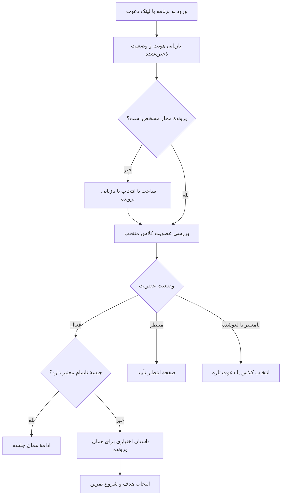

# بازبینی سه‌لایهٔ رابط ورود و شروع بازی نسخهٔ ۹

تاریخ: ۲۰۲۶/۱۰/۱۶

وضعیت: تحلیل و پیشنهاد اجرایی؛ تغییر رفتار برنامه و تغییر قرارداد قفل‌شده در این سند انجام نشده است.

**اصلاح بر اساس تصمیم بعدی مالک:** اولین ثبت نام باید در نقطهٔ معرفی قهرمانِ داستان انجام شود. داستان نقطهٔ ساخت هویت نمایشی است و پس از آن بازی، کلاس و نتیجه از همان پرونده استفاده می‌کنند. این تصمیم جای پیشنهاد قبلیِ ثبت نام پیش از داستان را می‌گیرد. بازبینی گسترده‌تر در `V9-GAME-EXPERIENCE-AUDIT.fa.md` آمده است.

مرجع: `V9-ARCHITECTURE.fa.md`، قرارداد و تصمیم‌های قفل‌شدهٔ فاز یک، و کد فعلی بازی ۸.۱ و پیش‌نمایش ۹.

## ۱. نتیجهٔ بررسی

تکرار نام و کد کلاس، پیامد چند مسیر مستقل هویت و کلاس است. راه‌حل، یکپارچه‌کردن وضعیت ورود، پرونده و عضویت است؛ حذف ظاهری چند کادر، ناسازگاری داده را حل نمی‌کند.

تصویر آزمون مالک، نمایش دو بازیکن در لیدربرد کلاس 918426 را نشان می‌دهد. این شاهد عملکرد مسیر امتیاز زنده است؛ همگام‌بودن پرونده، کلاسِ پنل معلم، داستان و عضویت را اثبات نمی‌کند. داده‌های این آزمون در این بازبینی حذف نمی‌شوند.

## ۲. یافته‌های قطعی در کد

| موضوع | محل | رفتار فعلی | پیامد |
|---|---|---|---|
| ورود کلاس | `join.html` | ذخیرهٔ `demo_player_id`، `demo_student_name` و `demo_class_code`؛ سپس رفتن به بازی | پروفایل اصلی بازی ساخته یا انتخاب نمی‌شود |
| پروفایل بازی | `profile-manager.js` و `src/ui/ui-controller.js` | ساخت شناسه و نام مستقل؛ در نبود پروفایل فعال، درخواست مجدد نام و آواتار | یک کودک می‌تواند دو شناسه و دو نام موازی داشته باشد |
| داستان | `src/ui/story.js` و `index.html` | اسلاید پایانی دوباره نام می‌پرسد و فقط پروفایل بازی را ویرایش می‌کند | نام قبلی لیدربرد در `demo_student_name` باقی می‌ماند |
| نتیجهٔ بازی | `src/games/multiplication-1x1/core-play.js` | پرونده از پروفایل/جلسه؛ لیدربرد با اولویت نام و شناسهٔ `demo_*` | امکان تفاوت نام و شناسهٔ پرونده و لیدربرد |
| کلاسِ معلم | `social-core.js` و `src/ui/classroom-ui.js` | کلاس و اعضا در `sw_classes_v1` همان مرورگر؛ کلاس فعال از `AppStorage` | ساخت کلاس روی دستگاه معلم به‌تنهایی آن را روی دستگاه کودک ایجاد نمی‌کند |
| کلاس زنده | `join.html` و `live-board.js` | کد شش‌رقمی، مستقیماً مسیر امتیاز Firebase را انتخاب می‌کند | دیدن امتیاز، به معنی عضویت تأییدشده در کلاسِ معلم نیست |
| سابقهٔ داستان و کلاس فعال | `src/core/utils.js` | نشانگر داستان و کلاس فعال در سطح مرورگر | در دستگاه مشترک، وضعیت یک کودک می‌تواند روی کودک دیگر اثر بگذارد |
| نام‌های یکسان | `ProfileManager.create` | رد نام تکراری در همان مرورگر | ناسازگار با قاعدهٔ معماری: دو کودک هم‌نام باید دو پرونده داشته باشند |
| مسیرهای شروع | `home.html`، `index.html` و `v9.html` | ورود از صفحهٔ خانه، بازی مستقیم و پیش‌نمایش مستقل | رفتار ورود به مسیر رسیدن وابسته است |
| پیش‌نمایش ۹ | `src/v9/app.js` | وضعیت محلی با کلید `profile:{uid}`؛ پیوستن تازه وضعیت فعلی را جایگزین می‌کند | انتخاب چند پرونده یا چند کلاس هنوز مدل کامل ندارد |
| پیوستن دوباره در ۹ | `server/service.js` | `studentId` از هویت و `requestId` ساخته می‌شود | درخواست تازه، برخلاف تکرار همان درخواست، می‌تواند پروندهٔ تازه بسازد |

توضیح محل داستان: در کد، سؤال نام در اسلاید چهارم، با شمارهٔ داخلی ۳، قرار دارد. تعداد کلیک‌های کاربر یا مسیر ورود ممکن است باعث شود آن را صفحهٔ سوم بنامد؛ مشکل همان درخواست مجدد نام است.

## ۳. انطباق با معماری قبلی

| اصل قبلی | وضعیت فعلی | اقدام موردنیاز |
|---|---|---|
| یک پروندهٔ ثابت برای هر کودک | در ۸.۱ چند شناسه وجود دارد؛ در پیش‌نمایش ۹ بازیابی کامل نیست | نگاشت شناسه‌های قدیمی به پروندهٔ منتخب و بازیابی مجاز |
| دستگاه، صاحب پرونده نیست | انتخاب پرونده در ۹ عملاً به وضعیت `uid` گره خورده | مدل چند پروندهٔ مجاز روی یک دستگاه |
| عضویت یکپارچهٔ کلاس | کلاس محلی و اتاق امتیاز جدا هستند | کلاس و عضویت معتبر سمت سرور |
| دو کودک هم‌نام مجازند | سازندهٔ پروفایل محلی نام تکراری را رد می‌کند | تمایز بر اساس شناسه و آواتار؛ نام غیر یکتا |
| رابط کوتاه و مناسب کودک | چند درخواست مستقل برای نام و کلاس | هماهنگ‌کنندهٔ واحد شروع |
| رتبه‌بندی پیش‌فرض خاموش | لیدربرد عمومی ۸.۱ فعال است | حفظ آن فقط به‌عنوان دموی قدیمی؛ اجرای D4 در رابط ۹ |

اصل معماری قبلی مناسب است، اما قرارداد جزئی صفحه‌ها، بازیابی وضعیت و اتصال مسیر قدیمی به رابط جدید کامل نشده است. پیش‌نمایش سرور نیز جای این قرارداد تعامل را پر نمی‌کند.

## ۴. لایهٔ مفهومی: تجربهٔ مطلوب

### قواعد پیشنهادی

1. کودک در یک فرایند ورود فقط یک بار نام نمایشی وارد کند. نام مستعار مجاز است؛ نام، اثبات هویت نیست.
2. برای کودک تازه، نام در لحظهٔ معرفی قهرمان در داستان ثبت شود. برای کودک شناخته‌شده، همان صحنه نام موجود را در روایت استفاده کند و ثبت دوباره نخواهد. ویرایش بعدی نام در پرونده انجام شود.
3. کد یا دعوت فقط هنگام پیوستن به کلاس جدید یا نامعتبرشدن دعوت درخواست شود. عضو معتبر دوباره کد نمی‌زند.
4. معلم پس از ساخت کلاس وارد همان کلاس شود؛ «ساخت کلاس» با «پیوستن دانش‌آموز» دو عمل متفاوت است.
5. کودک بازگشتی در دستگاه شخصی کارت «ادامهٔ تمرین — نام کودک — نام کلاس» ببیند.
6. در دستگاه مشترک، پیش از ادامه، پروندهٔ مجاز انتخاب شود؛ آخرین نام ذخیره‌شده نباید خودکار به کودک بعدی نسبت داده شود.
7. اگر چند کلاس وجود دارد، انتخاب کلاس جای ورود مجدد کد را بگیرد؛ نام و شناسهٔ کلاس منتخب آشکار باشد.
8. معلم یا کلاسِ فعال، حالت و هدف آموزشی را تعیین می‌کند. گزینه‌های فنی Core و Legacy در مسیر اصلی کودک نشان داده نشوند.
9. خروج از بازی، تغییر بازیکن، خروج از حساب و ترک کلاس چهار کار جدا باشند؛ هیچ‌کدام نباید ضمنی دیگری را انجام دهد.
10. صفحهٔ اصلی کودک بر ادامهٔ تمرین و پیشرفت خود او متمرکز باشد؛ لیدربرد عمومی، صفحهٔ پیش‌فرض نسخهٔ ۹ نباشد.

### مسیرهای ورود

| وضعیت | مسیر پیشنهادی |
|---|---|
| دانش‌آموز تازه با لینک دعوت | شناسایی دعوت بدون درخواست نام ← داستان و ثبت یک‌بارهٔ قهرمان ← عضویت ← تمرین |
| دانش‌آموز تازه با کد دستی | ورود دعوت/کد پشتیبانی‌شده ← همان مسیر بالا؛ فرم کد فقط یک بار |
| دانش‌آموز بازگشتی، یک پرونده و یک کلاس | بازیابی هویت و عضویت ← ادامهٔ تمرین یا تمرین تازه |
| دستگاه مشترک | انتخاب پروندهٔ مجاز ← انتخاب کلاس در صورت نیاز ← ادامه |
| عضو منتظر تأیید | «درخواستت برای معلم ارسال شد» و بررسی دوبارهٔ وضعیت؛ بدون ثبت‌نام دوباره |
| عضویت غیرفعال | توضیح و راه ارتباط با معلم؛ جلوگیری از شروع جلسهٔ جدید کلاس |
| معلم تازه | ورود معتبر ← ساخت کلاس ← صفحهٔ همان کلاس و اشتراک دعوت |
| معلم بازگشتی | ورود/بازیابی نشست ← فهرست کلاس‌ها یا آخرین کلاس معتبر |
| دستگاه دوم همان کودک | اتصال یا بازیابی تأییدشدهٔ همان پرونده؛ واردکردن نام مشابه کافی نیست |

تمرین مستقل بدون کلاس می‌تواند در مسیر قدیمی باقی بماند، اما اضافه‌شدن آن به سرور ۹ نیاز به تعیین مالکیت جلسه و قرارداد جدا دارد؛ نباید با یک عضویت ساختگی پیاده شود.

### متن‌های پیشنهادی

| موقعیت | متن اصلی | اقدام اصلی |
|---|---|---|
| اولین ورود در داستان | «ایستگاه به یک قهرمان نیاز دارد؛ نام قهرمان ما چیست؟» | شروع مأموریت |
| بازگشت | «سلام مینا؛ تمرین قبلی‌ات را ادامه می‌دهی؟» | ادامهٔ تمرین |
| داستان | «مینا، ایستگاه به کمک تو نیاز دارد.» | شروع تمرین |
| عضویت معلوم | «کلاس سوم الف — معلم: …» | ورود به کلاس |
| انتظار عضویت | «منتظر تأیید معلم هستی.» | بررسی وضعیت |
| تغییر بازیکن | «چه کسی می‌خواهد بازی کند؟» | انتخاب پرونده |

## ۵. لایهٔ داده: یک منبع معتبر برای هر مفهوم

| مفهوم | مرجع معتبر | استفادهٔ رابط |
|---|---|---|
| هویت واردشده و نقش | توکن معتبر و پاسخ سرور | نمایش امکانات مجاز؛ انتخاب نقش در رابط مجوز نمی‌سازد |
| پروندهٔ کودک | `studentId` و پروندهٔ سرور | نام نمایشی و آواتار؛ نام کلید اتصال نیست |
| دسترسی دستگاه | مجوز دستگاه به پرونده | فهرست پرونده‌های قابل انتخاب؛ نه فهرست عمومی کودکان |
| کلاس | `classId` و رکورد کلاس | عنوان، معلم و سیاست کلاس |
| عضویت | رابطهٔ کودک و کلاس با وضعیت سرور | فعال، منتظر، لغوشده؛ جلوگیری از حدس‌زدن وضعیت |
| وضعیت انتخاب | شناسهٔ پرونده و کلاس منتخب، وابسته به هویت فعلی | راهنمای مسیر؛ هر بار با مجوز سرور سنجیده شود |
| داستان | `storyVersionSeen` برای هر پرونده و نسخهٔ داستان | یک بار برای همان کودک؛ بازپخش اختیاری |
| تمرین | `sessionId` با `studentId` و `classId` ثابت | بازگشت به همان جلسه؛ تغییر کلاس، جلسه را منتقل نمی‌کند |
| پاسخ‌های منتظر | صف IndexedDB وابسته به هویت، پرونده و جلسه | ارسال با زمینهٔ اولیه؛ پاک‌نشدن با تعویض صفحه یا بازیکن |
| دعوت | پیش‌نویس محدود و وضعیت درخواست | ورود یک بار؛ حذف توکن مصرف‌شده از URL و وضعیت غیرضروری |

### تصمیم‌های لازم برای مهاجرت

- `demo_player_id` و `profileId` محلی را برابر با `studentId` معتبر فرض نکنیم. نگاشت مهاجرت با رضایت انتخاب پرونده و اعتبارسنجی دسترسی انجام شود.
- در اختلاف نام پروفایل و نام دمو، هر دو مقدار قبلی حفظ شوند و یک بار از کاربر انتخاب خواسته شود. این رفع تعارض است، نه ثبت‌نام دوباره در هر بازی.
- نام یکسان، کد کلاس یا مرورگر مشترک، معیار ادغام پرونده‌ها نباشد.
- کلاس ساخته‌شده در حافظهٔ محلی، خودکار عضویت سرور ایجاد نکند. معلمِ احرازشده باید آن را به کلاس سرور تبدیل کند.
- سوابق قدیمی با برچسب `legacy` نگهداری شوند؛ امتیاز دمو به پاسخ تأییدشدهٔ سرور تبدیل نشود.
- عملیات مهاجرت تکرارپذیر باشد و نگاشت شناسه‌ها را ثبت کند تا پروندهٔ تکراری نسازد.

## ۶. لایهٔ فنی: اجرای یک جریان واحد

یک هماهنگ‌کنندهٔ کوچک شروع برنامه پیشنهاد می‌شود. این کار به چارچوب رابط جدید یا بازنویسی هستهٔ ریاضی نیاز ندارد.

### اجزای پیشنهادی

| جزء | مسئولیت |
|---|---|
| `EntryCoordinator` | تعیین صفحهٔ بعد بر اساس هویت، پرونده، عضویت و جلسه |
| `IdentityRepository` | دریافت و نگهداری نمای مجاز پرونده‌ها |
| `MembershipRepository` | بررسی عضویت و کلاس؛ تبدیل خطا به وضعیت قابل نمایش |
| `SessionRepository` | ادامهٔ جلسه و حفاظت از زمینهٔ آن |
| `LegacyEntryAdapter` | خواندن داده‌های قدیمی و پیشنهاد مهاجرت؛ بدون ساختن چند منبع اصلی تازه |
| رابط داستان | تنها نقطهٔ ثبت اولیهٔ نام برای کودک تازه؛ برای کودک موجود صرفاً نمایش همان نام |

### قواعد اجرای رابط

- شروع از `home.html`، لینک دعوت، بازی مستقیم یا بازکردن دوباره، همگی از هماهنگ‌کنندهٔ یکسان عبور کنند.
- فقط یک صفحه یا پنجرهٔ اصلی در هر وضعیت فعال باشد. دستکاری پراکندهٔ چند `hidden` جای منطق ورود را نگیرد.
- پیش از درخواست تغییردهنده، `requestId` و پیش‌نویس مربوط به هویت/پرونده در ذخیرهٔ پایدار ثبت شوند؛ تکرار پس از قطع اینترنت همان درخواست را بفرستد.
- پاسخ دیررس درخواست مربوط به بازیکن قبلی، وضعیت بازیکن جدید را بازنویسی نکند. شنونده‌ها و درخواست‌ها به زمینهٔ هویت و پرونده وابسته باشند.
- تغییر بازیکن، صف قبلی را حذف نکند و پاسخ او را به کلاس یا پروندهٔ جدید نفرستد.
- آفلاین‌بودن، توکن منقضی، عضویت منتظر و مجوز لغوشده پیام‌های متفاوت داشته باشند؛ خطای شبکه با درخواست دوبارهٔ نام درمان نشود.
- ادامهٔ تمرین آفلاین فقط برای جلسهٔ قبلاً بارگذاری‌شده و قابل بازیابی عرضه شود. شروع سرد آفلاین تا پیاده‌سازی کش وعده داده نشود.
- بازخورد موقت آفلاین با رسید قطعی سرور تفاوت آشکار داشته باشد. لغو عضویت ممکن است پس از اتصال باعث رد ارسال شود؛ صف برای رسیدگی باقی بماند.
- تغییر نام فقط نمای پرونده را تغییر دهد؛ شناسه، مالکیت، سوابق و نمره را تغییر ندهد. سیاست نمایش نام فعلی یا نام تاریخی در گزارش باید صریح تعیین شود.
- در دستگاه مشترک، خروج از حساب و امکان بازیابی پروندهٔ ناشناس پیش از عرضه حل شود؛ نمایش آواتار به‌تنهایی مجوز دیدن پرونده نیست.

## ۷. شکاف‌های قرارداد؛ مانع اجرای کامل

قرارداد فاز یک پنج عملیات پایه دارد. مخفی‌کردن فرم‌ها به‌تنهایی، قابلیت‌های زیر را ایجاد نمی‌کند:

| نیاز رابط | شکاف فعلی | تصمیم لازم |
|---|---|---|
| بازگشت بدون کد و نام | فهرست پرونده‌ها و عضویت‌های مجاز دستگاه قرارداد کامل ندارد | عملیات بازیابی زمینهٔ ورود و فهرست محدود و مجاز |
| یک کودک در چند کلاس | `redeemInvite` شناسهٔ موجود کودک را نمی‌گیرد و در درخواست تازه شناسهٔ تازه می‌سازد | جداکردن ساخت پرونده از عضویت یا افزودن اتصال به پروندهٔ مجاز موجود |
| دستگاه مشترک | وضعیت فعلی `profile:{uid}` فقط یک انتخاب را نمایندگی می‌کند | چند پرونده و عضویت با انتخاب فعال مستقل |
| دستگاه دوم | بازیابی و صدور مجوز دستگاه کامل نشده است | فرایند محدود، قابل لغو و تأییدشده؛ بدون اتکا به نام |
| تغییر نام و آواتار | API صریح ویرایش پرونده وجود ندارد | عملیات محدود با بررسی مجوز و اعتبارسنجی |

نام و شکل دقیق عملیات جدید باید به‌عنوان الحاقیهٔ نسخه‌دار قرارداد تصویب و آزموده شود. قرارداد قفل‌شده یا D1–D4 در این سند تغییر نمی‌کنند. `uid` را برابر کودک فرض نکنیم؛ یک `uid` دستگاه مشترک می‌تواند چند پروندهٔ مجاز داشته باشد.

## ۸. دسترس‌پذیری و سادگی

قاعدهٔ WCAG 2.2، بند 3.3.7، برای اطلاعات تکراری در یک فرایند توصیه می‌کند مقدار قبلی در دسترس یا از پیش پر شده باشد؛ استثناهایی مانند امنیت یا نامعتبرشدن داده دارد. این معیار الزام به ذخیرهٔ اطلاعات بین همهٔ نشست‌ها نیست.

در این محصول پیشنهاد می‌شود فرم تکراری اصولاً نمایش داده نشود؛ نام و کلاس در کارت خلاصه با امکان ویرایش یا تغییر آگاهانه دیده شوند. هنگام بازگشت به فرم پس از خطا، ورودی قبلی حفظ شود. عنوان صفحه، تمرکز صفحه‌کلید، پیام وضعیت و مسیر بازگشت روشن باشند.

منبع رسمی: W3C، Understanding SC 3.3.7، به نشانی `https://www.w3.org/WAI/WCAG22/Understanding/redundant-entry.html`.

احراز هویت ناشناس Firebase با ساخت پروندهٔ آموزشی و اتصال دستگاه دوم یک مفهوم نیست. مستند Firebase ایجاد حساب ناشناس و اتصال بعدی اعتبارنامه را پشتیبانی می‌کند؛ قواعد نگاشت چند پروندهٔ کودک به مجوز دستگاه، مسئولیت برنامه است.

منبع رسمی: Firebase، Anonymous Authentication، به نشانی `https://firebase.google.com/docs/auth/web/anonymous-auth`.

## ۹. ترتیب پیشنهادی اجرا

| اولویت | تغییر | شرط پایان |
|---|---|---|
| فوری | قرار دادن ثبت اولیهٔ نام در داستان و حذف درخواست‌های نام پیش و پس از آن | نام قهرمان در بازی، پرونده و لیدربرد یکسان؛ بدون ادغام خودکار افراد |
| فوری | آشکارکردن تفاوت کلاس محلی و کلاس آنلاین در دورهٔ گذار | پیام «کلاس آنلاین ساخته شد» فقط پس از موفقیت سرور |
| پیش از بازطراحی رابط ۹ | تصویب الحاقیهٔ بازیابی زمینه، پرونده و عضویت | قرارداد و آزمون منع دسترسی؛ بدون تغییر خاموش فاز یک |
| بعد | هماهنگ‌کنندهٔ ورود و صفحه‌های دانش‌آموز/معلم | همهٔ ورودی‌ها از یک منطق عبور کنند |
| بعد | مهاجرت کنترل‌شده و ادامهٔ جلسه | بازگشت و اجرای دوباره بدون پرونده یا جلسهٔ تکراری |
| شرط انتشار | آزمون دستگاه مشترک، دو دستگاه، آفلاین و دسترس‌پذیری | قبولی سناریوهای زیر با API تولید |

رابط ۹ و اصلاح گذار ۸.۱ باید جداگانه قابل انتشار و بازگشت باشند. آزمون موفق لیدربرد، مجوز اعلام تکمیل هویت و کلاس ۹ نیست.

## ۱۰. آزمون‌های پذیرش

1. کودک تازه از لینک کلاس وارد شود؛ نام فقط در معرفی قهرمان داستان پرسیده شود و دعوت دوباره درخواست نشود.
2. نام داستان، نوار بازی، پرونده و نتیجه از همان پروندهٔ منتخب خوانده شود.
3. بستن و بازکردن روی دستگاه شخصی، کودک را به همان عضویت و جلسه برگرداند؛ کد دوباره لازم نباشد.
4. در دستگاه مشترک دو کودک، از جمله دو کودک هم‌نام، سابقه، داستان و صف مستقل داشته باشند.
5. تغییر نام، شناسه یا تاریخچه را تغییر ندهد و بازیکن تازه نسازد.
6. ساخت کلاس توسط معلم، پنل همان کلاس را باز کند؛ معلم کد کلاس خودش را برای ادامه وارد نکند.
7. عضویت pending یا revoked، مسیر مناسب نشان دهد؛ دکمهٔ شروع جلسهٔ کلاس فعال نباشد.
8. ورود چندباره به همان عضویت، حتی پس از گم‌شدن پاسخ، پروندهٔ تازه نسازد.
9. تغییر کلاس، پاسخ‌های جلسهٔ قبلی را به کلاس جدید نفرستد.
10. دستگاه دوم با مجوز به همان کودک متصل شود؛ نام یا کد کلاس به‌تنهایی این دسترسی را ندهد.
11. قطع اینترنت و ورود مجدد، فرم‌های تکمیل‌شده و صف را حفظ کنند؛ نتیجهٔ موقت به‌عنوان نتیجهٔ قطعی نمایش داده نشود.
12. تغییر بازیکن هنگام درخواست شبکه، باعث نمایش اطلاعات یا رسید بازیکن قبلی به بازیکن جدید نشود.
13. رتبه‌بندی نسخهٔ ۹ به‌صورت پیش‌فرض خاموش باشد؛ صفحهٔ دموی ۸.۱ با پیشرفت خصوصی اشتباه نشود.
14. ورود مستقیم به هر صفحه، دکمهٔ بازگشت، صفحه‌کلید، ارقام فارسی و صفحهٔ کوچک مسیر معتبر داشته باشند.

## ۱۱. محدودهٔ اعتبار این بازبینی

این تحلیل بر خواندن کد و اسناد محلی و تصویر تست مالک متکی است. بازبینی بصری تعاملی همهٔ مسیرها در Chrome و آزمون رابط ۹ روی API تولید در این نوبت انجام نشده است. باگ‌نداشتن مطلق از این تحلیل نتیجه نمی‌شود؛ سناریوهای پذیرش، مبنای قابل آزمون برای اصلاح بعدی هستند.
